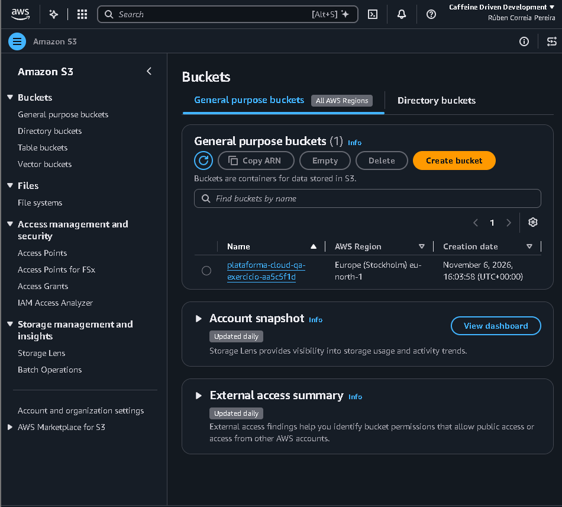
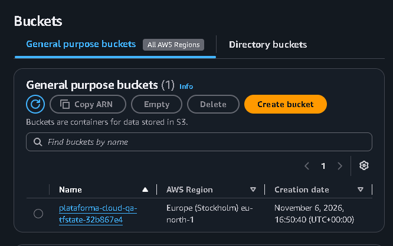
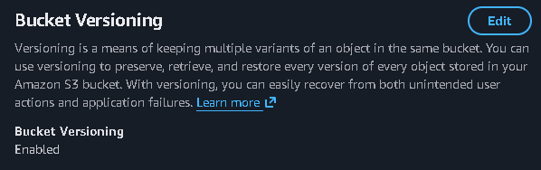
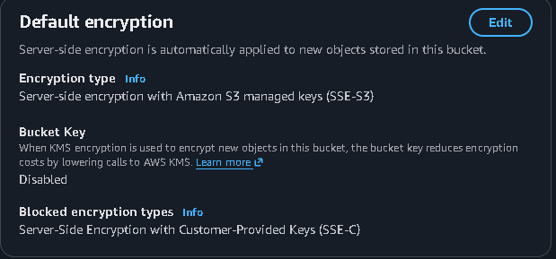
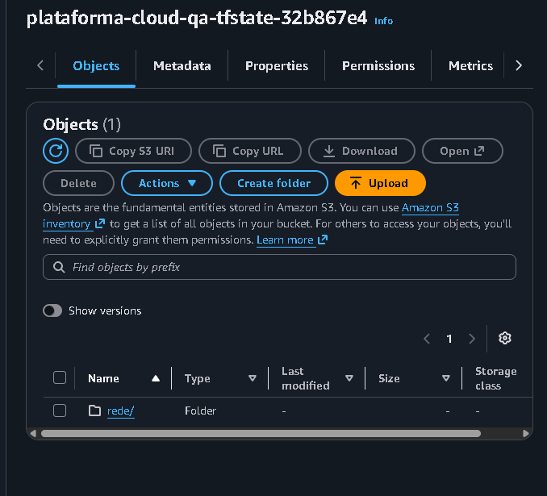
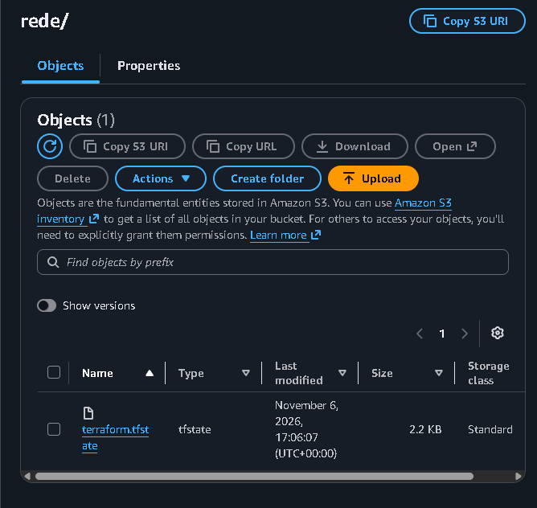
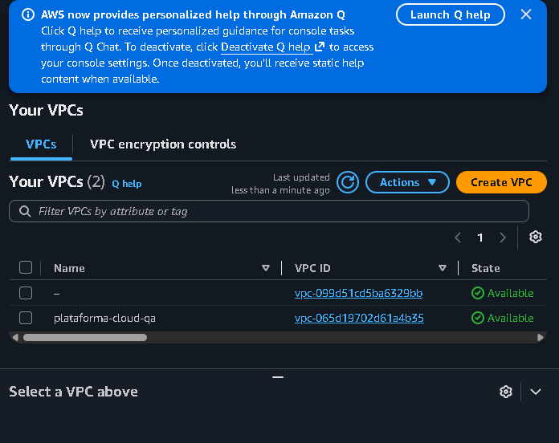

# Passo 03 – Terraform: infraestrutura como código

**Objetivo:** perceber o que é infraestrutura como código, aprender o ciclo do Terraform (`init`, `plan`, `apply`, `destroy`) e começar a criar a base da plataforma na AWS (estado remoto e rede).

**Partes deste passo:**

- A. Teoria e instalação do Terraform ✅
- B. Primeiro recurso: um bucket S3 de teste
- C. Estado remoto (bucket S3 para o *state*) (por fazer)
- D. Rede: VPC, sub-redes e internet gateway (por fazer)
- E. Fecho: outputs, destroy, documentação e commit (por fazer)

---

## 1. Teoria

### 1.1 Declarativo: descrever o resultado, não os passos

Há duas formas de pedir a alguém que construa uma casa:

- **Dar instruções passo a passo** ("compra tijolos, faz as fundações..."). Se a casa já existir pela metade, as instruções falham ou duplicam coisas.
- **Entregar a planta** ("quero uma casa com estes quartos"). Quem constrói vê o que já existe e faz só o que falta.

O Terraform funciona com a planta. Escreves o que queres que exista e ele descobre o que falta criar, alterar ou apagar. Chama-se programação **declarativa**.

### 1.2 Porquê Terraform e não consola, CLI ou outras ferramentas

| Forma | Problema para um projeto como este |
|---|---|
| Consola (cliques) | Não deixa registo e não se repete igual |
| AWS CLI (comandos) | Boa para tarefas pontuais, difícil de manter e desfazer |
| SDKs (código) | Demasiado trabalho para descrever infraestrutura |
| CloudFormation / CDK | Faz o mesmo, mas só funciona na AWS |
| **Terraform** | Infraestrutura como código, versionada no Git, reprodutível, funciona em várias clouds e é muito pedida no mercado |

### 1.3 As peças

| Conceito | Analogia | O que é |
|---|---|---|
| **Provider** | O tradutor | Plugin que sabe falar com uma plataforma (o `aws` fala com a AWS) |
| **Resource** | Um item da planta | Algo a criar (bucket, sub-rede, servidor) |
| **Data source** | Uma consulta | Lê informação que já existe, sem criar nada |
| **Variable** | Um campo a preencher | Valor que se pode mudar sem mexer no resto |
| **Output** | O recibo | Informação mostrada no fim |
| **Module** | Um bloco reutilizável | Conjunto de recursos que se usa várias vezes |
| **State** | A memória | Ficheiro onde o Terraform regista o que criou |

### 1.4 O ciclo de trabalho

```
terraform init  →  terraform plan  →  terraform apply  →  terraform destroy
```

| Comando | O que faz |
|---|---|
| `terraform init` | Prepara a pasta e descarrega os providers. Corre-se uma vez por projeto (e quando mudam os providers). |
| `terraform fmt` | Formata os ficheiros no estilo padrão. |
| `terraform validate` | Verifica se o código está bem escrito (sem ligar à AWS). |
| `terraform plan` | **Simula**: mostra o que seria criado (`+`), alterado (`~`) ou apagado (`-`). Não muda nada. |
| `terraform apply` | **Executa** o plano, depois de escreveres `yes`. |
| `terraform destroy` | Apaga tudo o que o Terraform criou nessa pasta. |

**Regra de ouro:** ler sempre o `plan` antes do `apply`.

### 1.5 O state

O state é o "caderno de memória" do Terraform: guarda quais recursos ele criou e as suas propriedades. Sem ele, o Terraform não saberia o que já existe.

- **Não vai para o Git:** pode conter dados sensíveis (está no `.gitignore`).
- **Não deve ficar só no teu portátil:** se o perderes, o Terraform "esquece" o que criou e os recursos ficam na AWS a gastar sem controlo.
- **Estado remoto:** guarda-se num bucket S3 cifrado, com versões e sem acesso público (Parte C).
- **Bloqueio (lock):** evita que duas execuções (tu e a pipeline, por exemplo) alterem o estado em simultâneo.

### 1.6 Idempotência e drift

- **Idempotente:** correr o `apply` duas vezes seguidas não muda nada à segunda, porque já está tudo como descrito.
- **Drift:** se alguém mudar algo à mão na consola, o `plan` seguinte mostra a diferença entre o código e a realidade. Por isso não se mexe à mão no que o Terraform gere.

### 1.7 Como se lê um ficheiro `.tf`

```hcl
provider "aws" {
  region = "eu-north-1"
}

resource "aws_s3_bucket" "meu_bucket" {
  bucket = "nome-unico-do-bucket"
}
```

A estrutura é `tipo "nome_do_tipo" "nome_interno" { propriedades }`. O Terraform lê todos os `.tf` da pasta. Por convenção: `versions.tf` (versões), `main.tf` (recursos), `variables.tf` (entradas) e `outputs.tf` (saídas).

Um recurso pode **referir** outro (`aws_s3_bucket.teste.id`). É assim que o Terraform percebe a ordem: cria primeiro o que é referido.

### 1.8 O ficheiro `.terraform.lock.hcl`

Criado pelo `terraform init`, fixa as versões exatas dos providers usados. **Deve ir para o Git**, para que toda a gente (e a pipeline) use exatamente as mesmas. A pasta `.terraform/`, essa, não vai.

### 1.9 Custos e regras de segurança

| Recurso | Custo |
|---|---|
| VPC, sub-redes, internet gateway, tabelas de rotas, security groups | Gratuitos |
| Bucket S3 (poucos ficheiros) | Praticamente nada |
| NAT Gateway, EKS, instâncias EC2 | **Cobram por hora** |

Regras que seguimos:

1. Só criamos o que o passo pede.
2. Evitamos o que cobra por hora até ser mesmo preciso.
3. Lemos o `plan` antes do `apply`.
4. No fim de cada sessão: `terraform destroy` e verificação de que não ficou nada ligado.
5. Tudo na mesma região (`eu-north-1`).

---

## 2. Prática

### Parte A – Instalar o Terraform ✅

```powershell
winget install Hashicorp.Terraform
terraform -version
```

No VS Code, instala a extensão **HashiCorp Terraform**.

### Parte B – Primeiro recurso: um bucket S3 de teste

**1. Ficheiros.** Cria a pasta `infra/00-exercicio-s3/` com 4 ficheiros:

```
infra/00-exercicio-s3/
├── versions.tf    # versões do Terraform e dos providers
├── main.tf        # provider, data source e recursos
├── variables.tf   # variável da região
└── outputs.tf     # o que é mostrado no fim
```

O que o código cria:

| Recurso | Para quê |
|---|---|
| `random_id.sufixo` | Sufixo aleatório, porque os nomes de buckets S3 são únicos no mundo |
| `aws_s3_bucket.teste` | O bucket em si |
| `aws_s3_bucket_public_access_block.teste` | Fecha todo o acesso público ao bucket |

**2. Entrar na pasta e preparar:**

```bash
cd infra/00-exercicio-s3
terraform init
terraform fmt
terraform validate
```

O `init` descarrega os providers `aws` e `random` e cria a pasta `.terraform/` e o ficheiro `.terraform.lock.hcl`. O `validate` deve dizer `Success! The configuration is valid.`

**3. Ver o plano (sem criar nada):**

```bash
terraform plan
```

Lê o resultado. Deves ver 3 recursos com `+` (a criar) e no fim `Plan: 3 to add, 0 to change, 0 to destroy.` Repara que alguns valores aparecem como `(known after apply)`: só se sabem depois de criados.

**4. Criar:**

```bash
terraform apply
```

Escreve `yes` quando pedir. No fim aparecem os **outputs** (nome do bucket, região e número da conta).

**5. Confirmar na AWS (de duas formas):**

```bash
aws s3 ls
terraform output
```

O bucket deve aparecer na lista. Podes também vê-lo na consola, em S3 (com a região `eu-north-1`).

**6. Provar a idempotência:**

```bash
terraform plan
```

Deve dizer `No changes. Your infrastructure matches the configuration.`

**7. Destruir:**

```bash
terraform destroy
```

Lê o que vai apagar, escreve `yes`, e confirma com `aws s3 ls` que o bucket desapareceu.

**8. Guardar no Git** (volta primeiro à raiz do projeto):

```bash
cd ../..
git status
git add .
git commit -m "feat: exercício de Terraform com bucket S3"
git push
```

No `git status` confirma que **não** aparecem a pasta `.terraform/` nem ficheiros `.tfstate`, e que o `.terraform.lock.hcl` **aparece** (esse deve ir).

**Prova visual:** o bucket criado pelo Terraform, visto na consola AWS (S3, região Europa/Estocolmo). A data de criação (16:03:58) coincide com o momento do `apply`.



### Parte C – Estado remoto ✅

**A ideia:** no exercício da Parte B o state ficou num ficheiro local. Se o computador avaria ou a pasta é apagada, o Terraform esquece-se do que criou, e numa equipa (ou numa pipeline) cada pessoa teria uma memória diferente. A solução é guardar o state num **backend remoto**: um bucket S3 central e seguro.

**O problema do ovo e da galinha:** para guardar o state num bucket, o bucket tem de existir primeiro. Por isso a parte faz-se em duas pastas:

| Pasta | O que cria | Onde fica o state |
|---|---|---|
| `infra/01-estado-remoto` | Só o bucket do state | Local (não pode ficar num bucket que ainda não existe) |
| `infra/02-rede` | A VPC (rede privada, gratuita) | No bucket, em `rede/terraform.tfstate` |

**O bucket do state** (`infra/01-estado-remoto`) tem proteções que o bucket de teste não tinha:

| Característica | Para quê |
|---|---|
| Versionamento | Guarda as versões antigas do state; se um `apply` o estragar, volta-se atrás |
| Encriptação (AES256) | O state pode conter dados sensíveis |
| Acesso público bloqueado | Ninguém de fora lhe chega |
| `prevent_destroy` | O Terraform recusa apagá-lo; perdê-lo é perder a memória de tudo |

Não tem `force_destroy`, ao contrário do bucket de teste.

**O backend** (`infra/02-rede/versions.tf`) diz ao Terraform onde guardar o state:

| Campo | O que faz |
|---|---|
| `bucket` | O bucket do state (escrito à mão: o bloco `backend` não aceita variáveis) |
| `key` | O caminho do ficheiro dentro do bucket; cada pasta do projeto usa a sua |
| `encrypt` | Encripta o ficheiro ao guardar |
| `use_lockfile` | Bloqueio nativo do S3: impede dois `apply` em simultâneo (desde o Terraform 1.10 já não é preciso DynamoDB) |

**Duas coisas que não se devem misturar:** a VPC não guarda o state; é só o primeiro recurso do projeto cuja memória ficou no bucket. E o backend decide *onde* o state vive; as *versões antigas* vêm do versionamento do bucket.

**Resultado:** o `terraform init` mostrou `Successfully configured the backend "s3"!`, o `apply` criou a VPC `vpc-065d19702d61a4b35` e o state apareceu no bucket. O segundo `plan` deu `No changes`, agora lendo o state a partir do S3.

O bucket do state, com versionamento ativo e encriptação por omissão:







A prova de que o state saiu do computador: a pasta `rede/` e, lá dentro, o `terraform.tfstate`, modificado à hora do `apply`:





A VPC criada pelo Terraform, vista na consola AWS (a outra, sem nome, é a VPC por omissão da AWS e não é nossa):



> **Nota:** o state da pasta `01-estado-remoto` continua local. É aceite, porque essa pasta quase nunca muda. Não se apaga o ficheiro `terraform.tfstate` dessa pasta.

### Parte D – Rede: sub-redes, internet gateway e rotas (por fazer)

### Parte E – Fecho (por fazer)

---

## 3. Registo do que fizeste

| Tarefa | Feito | Data | Notas |
|---|---|---|---|
| Terraform instalado | ✅ | 2026-11-05 | |
| `init`, `validate` e `plan` do exercício | ✅ | 2026-11-05 | Plano: 3 a criar, 0 a alterar, 0 a apagar |
| `apply`: bucket criado | ✅ | 2026-11-06 | 3 recursos criados |
| Bucket visto com `aws s3 ls` e na consola | ✅ | 2026-11-06 | Imagem em `docs/imagens/` |
| `plan` sem alterações (idempotência) | ✅ | 2026-11-06 | No changes |
| `destroy`: bucket removido | ✅ | 2026-11-06 | 3 recursos destruídos; `aws s3 ls` vazio |
| Commit e push do exercício | ✅ | 2026-11-06 | |
| Parte C: bucket do state criado (`01-estado-remoto`) | ✅ | 2026-11-06 | Versionamento e encriptação ativos |
| Parte C: backend S3 configurado e VPC criada (`02-rede`) | ✅ | 2026-11-06 | State em `rede/terraform.tfstate` |
| Parte C: `plan` sem alterações com state remoto | ✅ | 2026-11-06 | |
| Parte C: print da VPC na consola | ☐ | | `passo-03-vpc-consola.png` |
| Parte C: commit e push | ☐ | | |

## 4. Para a entrevista

**O que é infraestrutura como código e porque se usa?**
É descrever a infraestrutura em ficheiros versionados, em vez de a criar à mão. Torna-a reprodutível, revisável e fácil de destruir e recriar.

**Qual é a diferença entre programação declarativa e imperativa?**
Na declarativa descrevo o resultado pretendido e a ferramenta decide os passos (Terraform). Na imperativa descrevo os passos, um a um.

**Qual é a diferença entre `terraform plan` e `terraform apply`?**
O `plan` simula e mostra o que mudaria, sem alterar nada. O `apply` executa as mudanças. Lê-se sempre o `plan` antes de aplicar.

**O que é o state do Terraform e porque se guarda remotamente?**
É o registo do que o Terraform criou. Guarda-se remotamente (por exemplo, num bucket S3 cifrado e com versões) para não se perder, para poder ser partilhado e para evitar execuções simultâneas com bloqueio. Não vai para o Git porque pode conter dados sensíveis.

**O que é drift e como se deteta?**
É a diferença entre o código e a infraestrutura real, por exemplo quando alguém muda algo à mão. Deteta-se com o `terraform plan`.

**O que é um provider?**
Um plugin que permite ao Terraform falar com uma plataforma (AWS, Azure, etc.).

**Para que serve o `.terraform.lock.hcl`?**
Fixa as versões exatas dos providers, para que todos usem as mesmas. Vai para o Git.

**O que é um backend remoto e porque se usa?**
É o sítio onde o Terraform guarda o state. Em vez de ficar num ficheiro local, fica num bucket S3, para não se perder, ser partilhado pela equipa e pela pipeline, e ter bloqueio contra execuções simultâneas.

**Porque é que o bucket do state não pode guardar o seu próprio state logo à partida?**
Porque o bucket tem de existir antes de o state lá poder ficar (o problema do ovo e da galinha). Cria-se o bucket com state local e, a partir daí, as outras pastas usam-no como backend.

**Que proteções deve ter um bucket de state?**
Versionamento (para recuperar versões antigas), encriptação, acesso público bloqueado e proteção contra remoção acidental.

**O que faz o bloqueio do state (`use_lockfile`)?**
Impede que dois `apply` corram ao mesmo tempo sobre o mesmo state e o corrompam. Desde o Terraform 1.10 o S3 faz isto sozinho, sem tabela DynamoDB.