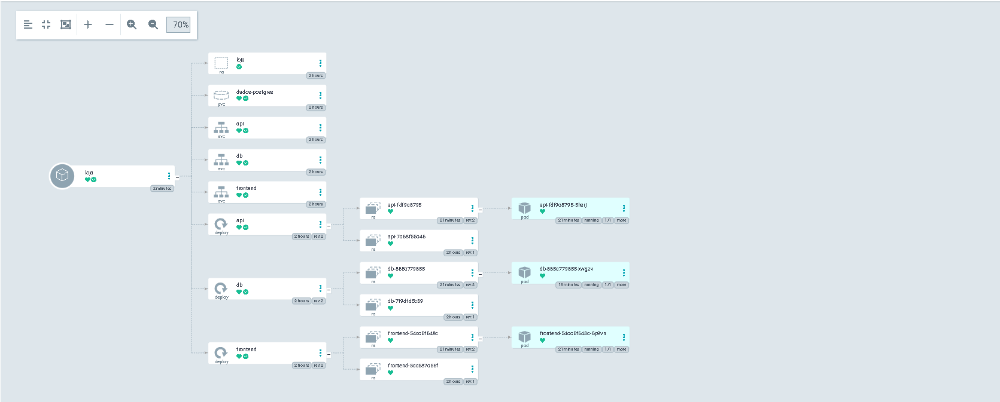

# Passo 05 – Kubernetes e ArgoCD (GitOps)

**Objetivo:** perceber o que é o Kubernetes e porque se usa, correr a aplicação da loja num cluster local (kind) e, no fim, deixar o ArgoCD a manter o cluster igual ao que está no Git (GitOps).

**Partes deste passo:**

- A. Teoria, instalação do kind e do kubectl, e criar o cluster ✅
- B. Pôr a aplicação no cluster: namespace, Deployments e Services ✅
- C. Sondas de saúde, limites de recursos e segurança dos contentores ✅
- D. ArgoCD: GitOps a vigiar a pasta `k8s/loja/` ✅
- E. Fecho: documentação, limpeza e commit (por fazer)

---

## 1. Teoria

### 1.1 O problema que o Kubernetes resolve

Com o Docker Compose, a aplicação corre numa única máquina. Isso chega para aprender, mas em produção há problemas:

- **Se um contentor morre**, ninguém o volta a arrancar (a não ser que o configures à mão).
- **Se a máquina morre**, cai tudo.
- **Escalar** (ter 3 cópias da API em vez de 1) é manual.
- **Atualizar** a aplicação sem a desligar não é simples.

O **Kubernetes** (abreviado K8s) é um **orquestrador de contentores**: gere os contentores por ti, em várias máquinas, e mantém-nos a funcionar.

### 1.2 A ideia central: dizes o que queres, ele mantém

O Kubernetes é **declarativo** (como o Terraform). Não dizes "arranca este contentor"; dizes **"quero sempre 2 cópias da API a correr"**. O Kubernetes compara continuamente o que **queres** com o que **existe** e corrige a diferença. A isto chama-se **ciclo de reconciliação**.

Exemplo: pedes 2 cópias, uma morre, o Kubernetes repara que só há 1 e cria outra. Tu não fizeste nada.

### 1.3 As peças

| Conceito | Analogia | O que é |
|---|---|---|
| **Cluster** | A empresa toda | O conjunto de máquinas geridas pelo Kubernetes |
| **Node (nó)** | Um armazém | Uma máquina do cluster onde correm contentores |
| **Control plane** | A direção | O "cérebro" que decide onde e o que corre |
| **Pod** | Uma caixa | A menor unidade: um ou mais contentores que vivem juntos |
| **Deployment** | A encomenda | Diz quantas cópias (réplicas) de um Pod queres e como as atualizar |
| **Service** | O número de telefone fixo | Dá um endereço estável a um grupo de Pods (que mudam de IP) e reparte o tráfego |
| **Namespace** | As pastas | Separa recursos dentro do cluster (ex.: `loja`, `argocd`) |
| **ConfigMap** | A folha de configuração | Configuração não sensível (URLs, opções) |
| **Secret** | O cofre | Valores sensíveis (palavras-passe) |
| **Manifest** | A planta | Ficheiro YAML que descreve um recurso |
| **kubectl** | O telecomando | Ferramenta de linha de comandos para falar com o cluster |

### 1.4 Do Docker Compose para o Kubernetes

O que fizemos no `docker-compose.yml` tem equivalente:

| Docker Compose | Kubernetes |
|---|---|
| `services:` (cada serviço) | **Deployment** (corre os contentores) + **Service** (dá o endereço) |
| Nome do serviço como *hostname* (`api`, `db`) | O nome do **Service** funciona como hostname dentro do namespace |
| `ports: "8080:8080"` | Service do tipo **NodePort** (ou Ingress) |
| `.env` | **ConfigMap** (não sensível) e **Secret** (sensível) |
| `healthcheck` | **Sondas** (*probes*) `liveness` e `readiness` |
| `depends_on: service_healthy` | Sonda `readiness`: o Service só envia tráfego a Pods prontos |
| `volumes:` | **PersistentVolume** (volume que sobrevive ao Pod) |

### 1.5 As duas sondas de saúde

Já temos os dois endpoints certos na API:

| Sonda | Pergunta | Endpoint | Se falhar |
|---|---|---|---|
| **liveness** | "Estás vivo?" | `/saude` | O Kubernetes **reinicia** o contentor |
| **readiness** | "Estás pronto para receber tráfego?" | `/pronto` | O Kubernetes **deixa de enviar tráfego** (mas não reinicia) |

Foi por isto que separámos `/saude` e `/pronto` no Passo 2.

### 1.6 Porquê kind e não EKS

| | **kind** | **EKS** (Kubernetes da AWS) |
|---|---|---|
| O que é | Kubernetes dentro de contentores Docker, no teu computador | Kubernetes gerido pela AWS |
| Custo | Gratuito | O control plane cobra por hora (cerca de 0,10 $/hora; confirmar na página de preços) |
| Para quê | Aprender e desenvolver | Produção |

Por isso desenvolvemos tudo em kind e usamos o EKS só em sessões curtas, se chegarmos a isso (registado como decisão no README). Os manifests são os mesmos nos dois.

### 1.7 kubectl e contextos

O `kubectl` fala com **um cluster de cada vez**, o chamado **contexto atual**. O kind cria o contexto `kind-plataforma`. Quando houver mais do que um cluster (por exemplo, o EKS), é fácil aplicar um comando no cluster errado; por isso o hábito é confirmar com:

```bash
kubectl config current-context
```

### 1.8 Memória

O kind corre o cluster dentro do Docker, por isso gasta memória do computador. Recomenda-se dar pelo menos 4 GB ao Docker Desktop (nas definições, em *Resources*, ou no ficheiro `.wslconfig` se usares WSL 2). Se o portátil ficar lento, apaga-se o cluster e recria-se quando for preciso; é descartável.

---

## 2. Prática

### Parte A – Instalar o kind e o kubectl e criar o cluster ✅

**1. Confirma que o Docker está a correr** (Docker Desktop aberto):

```bash
docker version
```

Tem de mostrar `Client` e `Server`. Se só mostrar o `Client`, abre o Docker Desktop e espera que arranque.

**2. Instala o kind e o kubectl** (PowerShell):

```powershell
winget install -e --id Kubernetes.kind
winget install -e --id Kubernetes.kubectl
```

**Fecha o terminal e abre outro** (para o Windows reconhecer os comandos novos). Confirma:

```powershell
kind version
kubectl version --client
```

> **Nota:** o Docker Desktop pode ter instalado o seu próprio `kubectl`. Se o `kubectl version --client` mostrar uma versão antiga ou der erro, é por esse conflito; diz-me e resolvemos.

**3. Cria o ficheiro `k8s/kind-cluster.yaml`** (já comentado) na raiz do projeto.

**4. Cria o cluster** (na raiz do projeto):

```bash
kind create cluster --name plataforma --config k8s/kind-cluster.yaml
```

Na primeira vez descarrega a imagem do nó, por isso pode demorar alguns minutos.

**5. Verifica que está vivo:**

```bash
kubectl config current-context
kubectl cluster-info
kubectl get nodes
kubectl get pods -A
```

- `current-context` deve dizer `kind-plataforma`.
- `get nodes` deve mostrar um nó `plataforma-control-plane` em estado `Ready`.
- `get pods -A` lista os Pods de todos os namespaces. Os do `kube-system` são o próprio Kubernetes a funcionar (DNS, rede, etc.); devem estar `Running`.

**6. Vê o nó no Docker Desktop.** Em *Containers* aparece um contentor `plataforma-control-plane`: o "servidor" Kubernetes é, literalmente, um contentor Docker.

**7. (Para perceberes que é descartável)**

```bash
kind delete cluster --name plataforma
```

Apaga o cluster todo. Só faz isto se quiseres treinar o ciclo; depois volta a criá-lo com o comando do ponto 4.

**Resultado.** Logo a seguir à criação o nó aparece `NotReady` e alguns Pods `Pending`: é normal, porque o cluster ainda está a configurar a rede. Alguns minutos depois:

```
kind-plataforma

NAME                       STATUS   ROLES           AGE     VERSION
plataforma-control-plane   Ready    control-plane   3m45s   v1.37.0

NAMESPACE            NAME                                               READY   STATUS
kube-system          coredns-559f6c778d-rx4p8                           1/1     Running
kube-system          coredns-559f6c778d-tpt2s                           1/1     Running
kube-system          etcd-plataforma-control-plane                      1/1     Running
kube-system          kindnet-9dscj                                      1/1     Running
kube-system          kube-apiserver-plataforma-control-plane            1/1     Running
kube-system          kube-controller-manager-plataforma-control-plane   1/1     Running
kube-system          kube-proxy-pth74                                   1/1     Running
kube-system          kube-scheduler-plataforma-control-plane            1/1     Running
local-path-storage   local-path-provisioner-75f7fc7dc5-nz8mz            1/1     Running
```

Os Pods do `kube-system` são o próprio Kubernetes:

| Pod | Para quê |
|---|---|
| `etcd` | A base de dados do cluster (guarda o estado pretendido) |
| `kube-apiserver` | A porta de entrada: tudo o que se faz com o `kubectl` passa por aqui |
| `kube-controller-manager` | Corre o ciclo de reconciliação |
| `kube-scheduler` | Decide em que nó corre cada Pod |
| `kube-proxy` e `kindnet` | A rede |
| `coredns` | O DNS (é o que faz o nome de um Service funcionar como hostname) |
| `local-path-provisioner` | Cria os volumes de armazenamento |

O nó é um contentor Docker. No Docker Desktop vê-se a ligação de portas `8081:30080` que definimos no `kind-cluster.yaml` e a porta da API do Kubernetes (`6443` dentro do contentor):


### Parte B – Pôr a aplicação no cluster ✅

**A ideia.** Em vez do `docker-compose.yml`, escrevemos ficheiros YAML (*manifests*) a dizer ao Kubernetes o que queremos. Ficam em `k8s/loja/`:

| Ficheiro | O que cria |
|---|---|
| `00-namespace.yaml` | O namespace `loja` (a "pasta" da aplicação) |
| `10-db.yaml` | Disco (PVC), Deployment do Postgres e Service `db` |
| `20-api.yaml` | Deployment da API e Service `api` |
| `30-frontend.yaml` | Deployment do nginx e Service `frontend` (NodePort 30080) |

**Conceitos novos:**

- **Labels e selector.** Os Pods levam uma etiqueta (`app: api`). O Deployment e o Service usam um *selector* para encontrar os Pods com essa etiqueta. É assim que ficam ligados, e não por nome.
- **PersistentVolumeClaim (PVC).** O "pedido de disco". Os Pods são descartáveis; os dados da base de dados ficam no PVC, que sobrevive. É o equivalente ao volume do Docker.
- **`strategy: Recreate` na base de dados.** Ao atualizar, apaga o Pod antigo antes de criar o novo, porque dois Postgres no mesmo disco estragavam os dados.
- **Service ClusterIP e NodePort.** ClusterIP só é acessível dentro do cluster (usamo-lo na `db` e na `api`). NodePort abre uma porta fixa no nó (usamo-lo no `frontend`, para o browser lá chegar).
- **Os nomes dos Services são os mesmos do Compose** (`db`, `api`). Por isso o `DATABASE_URL` e o `proxy_pass http://api:8000/` do nginx funcionam sem alterações.
- **Secret fora do Git.** O `db-credenciais` cria-se à mão, a partir do `.env` (que não vai para o Git). Uma palavra-passe escrita num YAML no repositório ficaria exposta. No Passo 6 veremos formas mais robustas de gerir segredos.
- **Imagens locais e `imagePullPolicy: IfNotPresent`.** As imagens `loja-api:0.1` e `loja-frontend:0.1` não estão em nenhum registo; constroem-se no teu computador e carregam-se para o nó com `kind load`. Usa-se uma versão fixa (`0.1`) e não `latest`, porque com `latest` o Kubernetes tentaria sempre descarregar a imagem e falharia.
- **Uma só réplica da API para começar.** O arranque cria a tabela e semeia dois produtos; um só Pod evita corridas. Depois escala-se.

**Passos (na raiz do projeto, PowerShell):**

**1. Constrói as imagens com um nome e versão fixos:**

```powershell
docker build -t loja-api:0.1 ./app/api
docker build -t loja-frontend:0.1 ./app/frontend
```

**2. Carrega-as para dentro do cluster:**

```powershell
kind load docker-image loja-api:0.1 loja-frontend:0.1 --name plataforma
```

**3. Cria o namespace:**

```powershell
kubectl apply -f k8s/loja/00-namespace.yaml
```

**4. Cria o Secret a partir do `.env`** (a palavra-passe não aparece no terminal nem no Git):

```powershell
kubectl create secret generic db-credenciais --namespace loja --from-env-file=.env
```

**5. Aplica o resto:**

```powershell
kubectl apply -f k8s/loja/
```

**6. Acompanha os Pods a arrancar:**

```powershell
kubectl get pods -n loja
kubectl get pods -n loja -w
```

(`-w` fica a acompanhar; sai com `Ctrl+C`.) Devem passar a `Running`. Se algum ficar noutro estado, vê a causa com `kubectl describe pod <nome> -n loja` e `kubectl logs <nome> -n loja`.

**7. Abre a loja:** `http://localhost:8081`.

**8. Experiências (para perceber o Kubernetes):**

```powershell
# Apaga o Pod da API; o Deployment cria outro sozinho
kubectl delete pod -n loja -l app=api
kubectl get pods -n loja

# Escala a API para 3 cópias
kubectl scale deployment api -n loja --replicas=3
kubectl get pods -n loja

# Volta a 1
kubectl scale deployment api -n loja --replicas=1
```

**Resultados das experiências (2026-11-08):**

*Experiência 1 – apagar o Pod da API.* O Deployment criou outro de imediato (nome novo, mesmo ReplicaSet `api-7c68f55c46`); `db` e `frontend` ficaram intactos (`AGE 4m32s`):

```text
pod "api-7c68f55c46-rxh4s" deleted from loja namespace
NAME                        READY   STATUS    RESTARTS   AGE
api-7c68f55c46-kpgmk        1/1     Running   0          5s
db-7f9dfd5c69-7jnfd         1/1     Running   0          4m32s
frontend-5cc587c56f-4cz4s   1/1     Running   0          4m32s
```

*Experiência 2 – escalar a API.* Com `--replicas=3` o Kubernetes só criou os 2 Pods que faltavam (o `kpgmk` manteve-se). Com `--replicas=1` removeu os 2 mais novos:

```text
api-7c68f55c46-kpgmk        1/1     Running   0          43s
api-7c68f55c46-l7t2l        1/1     Running   0          3s
api-7c68f55c46-v72qg        1/1     Running   0          3s
(...depois de --replicas=1: só o kpgmk)
```

*Experiência 3 – apagar o Pod da base de dados.* O Pod foi substituído (`db-...-7jnfd` → `db-...-jkm7t`) e voltou a ligar ao mesmo PVC. Reparar que aparece `1/1 Running` com 4 s, antes de o Postgres estar de facto pronto: sem sondas o Kubernetes não sabe. Isto motiva a Parte C:

```text
pod "db-7f9dfd5c69-7jnfd" deleted from loja namespace
db-7f9dfd5c69-jkm7t         1/1     Running   0          4s
```

**Prints desta parte** (quando estiver a funcionar):

| Quando | O que mostrar | Nome sugerido |
|---|---|---|
| Loja a correr no Kubernetes | O browser em `localhost:8081` com a lista de produtos | `passo-05-loja-no-kubernetes.png` |
| Réplicas | O Docker Desktop não serve; usa o resultado do `kubectl get pods -n loja` com 3 réplicas da API, em texto no doc | (texto) |

### Parte C – Sondas de saúde, recursos e segurança ✅

**O problema que vamos resolver.** Na Parte B viste o Pod da base de dados aparecer `1/1 Running` com 4 segundos, quando o Postgres ainda não aceitava ligações. O Kubernetes só sabe que o contentor **arrancou**, não sabe se a aplicação lá dentro **funciona**. Nesta parte ensinamos-lhe três coisas.

**1. Sondas (probes): "como está a aplicação?"**

| Sonda | Pergunta | Se falhar | Onde usamos |
|---|---|---|---|
| **Readiness** | "Estás pronta a receber pedidos?" | O Pod fica `0/1` e o Service **deixa de lhe enviar tráfego**. Não reinicia. | API: `/pronto` (testa a DB). DB: `pg_isready`. Frontend: `/healthz`. |
| **Liveness** | "Estás viva?" | O Kubernetes **reinicia** o contentor. | API: `/saude` (não depende da DB). DB e frontend como acima. |

Porque são duas e não uma: se a base de dados cair, reiniciar a API não resolve nada. O correto é **tirá-la do tráfego** (readiness) até a DB voltar e **não** a reiniciar (liveness). Por isso `/saude` não toca na base de dados e `/pronto` toca. Isto já estava preparado na API desde o Passo 2.

A base de dados não tem endereço HTTP, por isso usa uma sonda do tipo `exec`: o Kubernetes corre o comando `pg_isready` dentro do contentor e vê se sai com sucesso.

**2. Recursos: `requests` e `limits`.**

- `requests` é o mínimo garantido. O Kubernetes usa-o para decidir em que nó o Pod cabe.
- `limits` é o máximo permitido. Se um contentor passa o limite de **memória**, é morto (`OOMKilled`). Se passa o de **CPU**, é só abrandado.
- Sem isto, um Pod com um erro (uma fuga de memória, por exemplo) podia consumir a máquina toda e arrastar os outros. `50m` de CPU é 5% de um núcleo; `64Mi` são 64 mebibytes.

**3. `securityContext`: princípio do menor privilégio.**

- `runAsNonRoot` + `runAsUser`: o contentor recusa arrancar se for root. A API usa o UID 1001 (o `appuser` do Dockerfile) e o nginx o UID 101.
- `allowPrivilegeEscalation: false`: o processo não pode ganhar mais poderes do que tem.
- `capabilities: drop: ["ALL"]`: retira as capacidades especiais do Linux que a loja não usa.
- `seccompProfile: RuntimeDefault`: bloqueia chamadas perigosas ao sistema operativo.
- **Exceção consciente:** a base de dados não leva `runAsNonRoot`, porque a imagem do Postgres arranca como root só para preparar a pasta de dados e depois passa para o utilizador `postgres`. Está comentado no ficheiro.

**E o ConfigMap?** Estava no plano, mas a nossa API só tem uma configuração (`DATABASE_URL`) e leva a palavra-passe, por isso fica no Secret. Um ConfigMap só faz sentido quando houver configuração **não secreta** (por exemplo, o nível de logs). Quando a houver, entra, e sabes que existe para isso.

**Passo a passo:**

**1.** Substitui os três ficheiros em `k8s/loja/` pelas versões novas (`10-db.yaml`, `20-api.yaml`, `30-frontend.yaml`). Lê os comentários: cada bloco novo está explicado.

**2.** Aplica e observa:

```powershell
kubectl apply -f k8s/loja/
kubectl get pods -n loja -w
```

Esperado no `apply`: os 3 Deployments `configured`; o resto `unchanged`. No `get pods -w` (sai com `Ctrl+C`): aparecem Pods novos, primeiro `0/1 Running` durante uns segundos e só depois `1/1`. **Esse `0/1` é a readiness a funcionar**, e é o que na Parte B não víamos. O Pod da DB também é recriado (estratégia `Recreate`), mas os dados mantêm-se no PVC.

**3.** Confirma que o Kubernetes leu as sondas e os limites:

```powershell
kubectl describe pod -n loja -l app=api
```

Procura as linhas `Liveness:`, `Readiness:`, `Limits:` e `Requests:`.

**4.** Confirma que a API já não corre como root:

```powershell
kubectl exec -n loja deploy/api -- id
```

Esperado: `uid=1001(appuser)`.

**5. Experiência principal: deixa a base de dados cair.**

```powershell
kubectl scale deployment db -n loja --replicas=0
kubectl get pods -n loja -w
```

Espera uns 15 segundos (3 falhas de readiness × 5 s). Vais ver a API passar a `0/1` **com `RESTARTS` a 0**: o Kubernetes tirou-a do tráfego mas **não a reiniciou**, porque a `/saude` continua a responder. Recarrega a loja no browser: dá erro (o Service `api` ficou sem Pods prontos). Depois repõe:

```powershell
kubectl scale deployment db -n loja --replicas=1
kubectl get pods -n loja -w
```

Quando a DB ficar `1/1`, a API volta sozinha a `1/1` e a loja recupera com os produtos todos. Sem tocar em nada à mão.

**Resultados (2026-11-08):**

*`apply`:* os 3 Deployments ficaram `configured`. No `get pods -w`, os Pods novos nasceram `0/1` e só passaram a `1/1` depois de a sonda responder (frontend e db em cerca de 6 s). Frontend e API usam `RollingUpdate`: o Pod antigo só terminou depois de o novo estar pronto. A base de dados usa `Recreate`: o Pod antigo desapareceu antes de o novo nascer.

```text
api-fdf9c8795-5hsrj         0/1     Running   0          5s
db-865c779855-qh6sw         0/1     Running   0          5s
frontend-54cc6f648c-6p9vn   0/1     Running   0          5s
frontend-54cc6f648c-6p9vn   1/1     Running   0          6s
db-865c779855-qh6sw         1/1     Running   0          6s
```

*`describe pod` da API (excertos):*

```text
    SeccompProfile:  RuntimeDefault
    Ready:           True
    Restart Count:   0
    Limits:
      cpu:     250m
      memory:  256Mi
    Requests:
      cpu:      50m
      memory:   64Mi
    Liveness:   http-get http://:8000/saude delay=10s timeout=2s period=10s #success=1 #failure=3
    Readiness:  http-get http://:8000/pronto delay=3s timeout=2s period=5s #success=1 #failure=3
QoS Class:                   Burstable
Events:
  Warning  Unhealthy  49s   kubelet  Readiness probe failed: Get "http://10.244.0.13:8000/pronto": dial tcp 10.244.0.13:8000: connect: connection refused
```

O `Warning` no arranque é esperado: a API ainda não estava a ouvir, a readiness falhou, o Pod ficou fora do tráfego e passou a `Ready` quando respondeu, sem reiniciar (`Restart Count: 0`).

*`exec ... id`:* o contentor corre sem privilégios.

```text
uid=1001(appuser) gid=1001(appuser) groups=1001(appuser)
```

*Experiência: base de dados em baixo.* Com `--replicas=0` na DB, a API passou a `0/1` ao fim de cerca de 10 s, **sem reiniciar** (`RESTARTS 0`); o frontend manteve-se `1/1`. Ao repor a DB, a API voltou sozinha a `1/1`, ainda com `RESTARTS 0`:

```text
(DB a 0 réplicas)
api-fdf9c8795-5hsrj         1/1     Running   0          2m2s
api-fdf9c8795-5hsrj         0/1     Running   0          2m12s

(DB reposta; depois de a sonda do Postgres passar)
api-fdf9c8795-5hsrj         1/1     Running   0          2m57s
db-865c779855-xwgzv         1/1     Running   0          28s
frontend-54cc6f648c-6p9vn   1/1     Running   0          2m57s
```

Isto prova a diferença entre as duas sondas: a readiness (`/pronto`, depende da DB) tirou a API do tráfego; a liveness (`/saude`, independente da DB) não disparou, por isso não houve reinício.

**Prints desta parte:** nenhum é necessário. Tudo o que importa é texto do terminal e vai para o doc como texto (cola-me o `get pods` da experiência 5, com a API a `0/1` e `RESTARTS 0`).

### Parte D – ArgoCD: GitOps ✅

**O que é GitOps.** Até agora, para alterar a loja corrias `kubectl apply` no teu computador. O problema: o que está no cluster pode ficar diferente do que está no Git, e ninguém sabe quem mudou o quê. Em GitOps, o **Git é a única fonte da verdade** e uma ferramenta dentro do cluster, o **ArgoCD**, compara continuamente a pasta `k8s/loja/` do GitHub com o que existe no cluster e corrige as diferenças. Para alterar a loja, fazes `git push`. Não há `kubectl apply`.

Isto dá três vantagens: cada alteração fica no histórico do Git (quem, quando, porquê); voltar atrás é um `git revert`; e alterações feitas à mão no cluster são desfeitas automaticamente.

**Como o ArgoCD funciona:**

- Instala-se **dentro** do cluster, no namespace `argocd`, como mais uma aplicação (vários Pods).
- Cria um tipo novo de recurso, a **Application**, que diz "vigia este repositório, esta pasta, e aplica neste namespace".
- Compara o Git (estado desejado) com o cluster (estado real). Se são iguais, o estado é `Synced`. Se diferem, é `OutOfSync` e ele sincroniza.
- Não precisa de credenciais porque o repositório é **público** (decisão de 2026-11-08).

**0. Antes de começar: repositório público.** Tudo o que está no Git é agora visível a qualquer pessoa. Já pesquisámos chaves AWS e não apareceu nada, e o `.env` está fora do Git. Falta rever as **imagens** em `docs/imagens/`: abre cada uma e confirma que não mostra o ID da conta AWS, o teu email, ou a barra de favoritos com nomes pessoais. Se mostrar, corta ou repete o print.

**1. Instalar o ArgoCD** (cria o namespace e aplica os manifests oficiais):

```powershell
kubectl create namespace argocd
kubectl apply -n argocd --server-side --force-conflicts -f https://raw.githubusercontent.com/argoproj/argo-cd/stable/manifests/install.yaml
kubectl get pods -n argocd -w
```

O `--server-side` é necessário porque alguns recursos do ArgoCD são grandes demais para o `apply` normal. Espera até todos os Pods estarem `1/1 Running` (cerca de 1 a 2 minutos) e sai com `Ctrl+C`. **Aviso:** o ArgoCD usa cerca de 1 GB de memória. Se o portátil ficar lento, fecha o Docker Compose e outras aplicações.

**2. Obter a palavra-passe inicial do utilizador `admin`:**

```powershell
[Text.Encoding]::UTF8.GetString([Convert]::FromBase64String((kubectl -n argocd get secret argocd-initial-admin-secret -o jsonpath="{.data.password}")))
```

O Secret guarda-a em base64 (que não é encriptação) e o comando descodifica-a. **Não a cole no chat nem em prints.** Guarda-a só para ti.

**3. Abrir a interface web.** O ArgoCD não está exposto ao exterior. O `port-forward` liga uma porta do teu computador ao Service dentro do cluster, enquanto o comando estiver a correr:

```powershell
kubectl port-forward svc/argocd-server -n argocd 8082:443
```

Deixa este terminal aberto e abre outro. No browser vai a `https://localhost:8082`. Vai aparecer um aviso de certificado (o ArgoCD usa um certificado que ele próprio gerou): escolhe "Avançadas" e continua. Entra com o utilizador `admin` e a palavra-passe do passo 2.

**4. Dizer ao ArgoCD o que vigiar.** O ficheiro `k8s/argocd/aplicacao-loja.yaml` define a Application (está todo comentado). Aplica-o uma única vez:

```powershell
kubectl apply -f k8s/argocd/aplicacao-loja.yaml
kubectl get applications -n argocd
```

Esperado: a aplicação `loja` aparece com `SYNC STATUS` `Synced` e `HEALTH STATUS` `Healthy`. Na interface web, clica na aplicação `loja` e vês o desenho dos recursos (Deployments, Services, Pods) todos a verde. O ArgoCD "adotou" a loja que já estava a correr, porque os manifests no Git são iguais ao que já estava no cluster.

**5. Experiência A: uma alteração por Git.** Muda `replicas: 1` para `replicas: 2` no `k8s/loja/30-frontend.yaml`, faz commit e push:

```powershell
git add k8s/loja/30-frontend.yaml
git commit -m "Frontend com 2 réplicas (teste GitOps)"
git push
kubectl get pods -n loja -w
```

O ArgoCD verifica o repositório de 3 em 3 minutos. Para não esperar, na interface clica em **Refresh** na aplicação. Vais ver aparecer um segundo Pod `frontend`, sem teres corrido `kubectl apply`. Depois **volta a pôr 1**, com outro commit e push.

**6. Experiência B: alteração à mão desfeita (self-heal).**

```powershell
kubectl scale deployment frontend -n loja --replicas=5
kubectl get pods -n loja -w
```

Vais ver Pods a nascer e, passado pouco tempo, o ArgoCD volta a pôr o número que está no Git e os Pods a mais desaparecem. Isto é o `selfHeal: true` do ficheiro.

**Resultados (2026-11-08):**

*Instalação.* O `apply --server-side` aplicou os 3 CRDs, as permissões e os 7 componentes sem erros. Os Pods passaram por `ContainerCreating` e `Init:0/1` (a descarregar imagens) e, ao fim de cerca de 50 s, estavam todos `1/1 Running`. O `argocd-repo-server` e o `argocd-server` demoraram mais a ficar prontos, por causa da readiness. Versão: ArgoCD 3.6.1.

```text
argocd-application-controller-0                     1/1     Running   0          53s
argocd-applicationset-controller-794bb95c9d-slccr   1/1     Running   0          53s
argocd-dex-server-66cf64bfcf-fd85v                  1/1     Running   0          53s
argocd-notifications-controller-5878c8d644-7fxgh    1/1     Running   0          53s
argocd-redis-5869b7547-m9mtg                        1/1     Running   0          53s
argocd-repo-server-7d55cc466b-jzxjs                 1/1     Running   0          53s
argocd-server-85b849c688-s7phs                      1/1     Running   0          53s
```

*Application `loja`.* Depois de `kubectl apply -f k8s/argocd/aplicacao-loja.yaml`, o ArgoCD leu `k8s/loja/` do GitHub, comparou com o namespace `loja` e verificou que eram iguais, por isso adotou a loja sem recriar nada:

```text
application.argoproj.io/loja created
NAME   SYNC STATUS   HEALTH STATUS
loja   Synced        Healthy
```

Na árvore da interface vê-se o namespace, o PVC, os 3 Services, os 3 Deployments e, em cada Deployment, dois ReplicaSets: `rev:1` (anterior à Parte C, guardado sem Pods, o que permite rollback) e `rev:2` (atual, com 1 Pod). O Secret `db-credenciais` não aparece porque não está no Git.



*Experiência A – alteração por Git.* Mudei `replicas: 1` para `2` no `k8s/loja/30-frontend.yaml`, fiz commit e push, sem correr `kubectl apply`. O ArgoCD detetou a diferença e o Kubernetes criou o Pod que faltava; o Pod antigo (`AGE 27m`) não foi tocado e a aplicação voltou a `Synced`:

```text
frontend-54cc6f648c-6p9vn   1/1     Running   0          27m
frontend-54cc6f648c-jzstf   1/1     Running   0          7s
NAME   SYNC STATUS   HEALTH STATUS
loja   Synced        Healthy
```

*Experiência B – self-heal.* Com o Git a dizer 2, fiz `kubectl scale ... --replicas=5` à mão. O ArgoCD repôs o estado do Git em poucos segundos: os Pods novos já estavam `Terminating` aos 4 s, sem chegarem a `1/1`. O resultado final foi 2 Pods `Running` e a aplicação `Synced`. O `kubectl scale` não alterou nada de forma duradoura: quem manda é o Git.

```text
frontend-54cc6f648c-4g5lx   0/1     Terminating   0          4s
frontend-54cc6f648c-f2wl7   0/1     Terminating   0          4s
frontend-54cc6f648c-6p9vn   1/1     Running       0          28m
frontend-54cc6f648c-jzstf   1/1     Running       0          51s
```

*Repor 1 réplica.* Voltei a pôr `replicas: 1` no ficheiro, commit e push; o ArgoCD removeu o Pod a mais (ficou o mais antigo, `6p9vn`) e a aplicação ficou `Synced` e `Healthy`.

**Prints desta parte (vale a pena guardar):**

| Quando | O que mostrar | Nome sugerido |
|---|---|---|
| Passo 4 | A aplicação `loja` na interface do ArgoCD, `Synced` e `Healthy`, com a árvore de recursos visível | `passo-05-argocd-loja-synced.png` |
| Passo 6 (opcional) | A interface do ArgoCD durante o self-heal, se apanhares o `OutOfSync` | `passo-05-argocd-self-heal.png` |

Na barra de endereço cuidado para não apareceres com nada pessoal. Não mostres a palavra-passe em nenhum print.

### Parte E – Fecho (por fazer)

---

## 3. Registo do que fizeste

| Tarefa | Feito | Data | Notas |
|---|---|---|---|
| kind e kubectl instalados | ✅ | 2026-11-08 | |
| Cluster `plataforma` criado | ✅ | 2026-11-08 | Kubernetes v1.37.0, um nó |
| `kubectl get nodes` mostra o nó `Ready` | ✅ | 2026-11-08 | |
| Print do Docker Desktop guardado | ✅ | 2026-11-08 | `passo-05-kind-no-docker-desktop.png` |
| Commit e push da Parte A | ✅ | 2026-11-08 | |
| Imagens `loja-api:0.1` e `loja-frontend:0.1` construídas | ✅ | 2026-11-08 | |
| Imagens carregadas no cluster (`kind load`) | ✅ | 2026-11-08 | |
| Namespace e Secret criados | ✅ | 2026-11-08 | |
| `kubectl apply -f k8s/loja/` e Pods em `Running` | ✅ | 2026-11-08 | |
| Loja a funcionar em `localhost:8081` | ✅ | 2026-11-08 | |
| Experiências: apagar Pod, escalar, apagar a DB | ✅ | 2026-11-08 | Os 3 produtos continuaram na loja: o PVC guardou os dados |
| Print da loja no Kubernetes | ✅ | 2026-11-08 | `passo-05-loja-no-kubernetes.png` (com a barra `localhost:8081`) |
| Parte C: manifests com sondas, recursos e `securityContext` aplicados | ✅ | 2026-11-08 | |
| `describe` mostra Liveness, Readiness, Limits | ✅ | 2026-11-08 | |
| `exec ... id` mostra `uid=1001(appuser)` | ✅ | 2026-11-08 | |
| Experiência: DB em 0 réplicas, API `0/1` sem reiniciar, recupera sozinha | ✅ | 2026-11-08 | `RESTARTS 0` durante todo o teste |
| Commit e push da Parte C | ✅ | 2026-11-08 | |
| Parte D: imagens do repositório revistas (sem dados pessoais) | ✅ | 2026-11-08 | Sem chaves nem ID de conta; nome e faculdade visíveis em alguns prints, aceite |
| ArgoCD instalado, Pods `Running` | ✅ | 2026-11-08 | 7 Pods `1/1`, versão 3.6.1 |
| Interface do ArgoCD acessível por `port-forward` | ✅ | 2026-11-08 | `https://localhost:8082` |
| Application `loja` `Synced` e `Healthy` | ✅ | 2026-11-08 | |
| Experiência A: alteração por `git push` aplicada pelo ArgoCD | ✅ | 2026-11-08 | 2.º Pod `frontend` criado sem `kubectl apply` |
| Experiência B: `kubectl scale` desfeito pelo self-heal | ✅ | 2026-11-08 | Pods a mais `Terminating` aos 4 s |
| Print `passo-05-argocd-loja-synced.png` | ✅ | 2026-11-08 | Cortado, sem email |
| Commit e push da Parte D | ☐ | | |

## 4. Para a entrevista

**O que é o Kubernetes e porque se usa em vez de só Docker Compose?**
É um orquestrador de contentores: mantém o número pretendido de cópias, reinicia o que falha, reparte tráfego e permite atualizar sem parar a aplicação, em várias máquinas. O Compose gere contentores numa só máquina.

**O que quer dizer que o Kubernetes é declarativo?**
Descrevo o estado pretendido (por exemplo, 2 réplicas) e o Kubernetes compara-o continuamente com o estado real e corrige a diferença. Chama-se ciclo de reconciliação.

**Qual é a diferença entre um Pod e um Deployment?**
O Pod é a menor unidade, um ou mais contentores. O Deployment descreve quantas réplicas de um Pod quero e como as atualizar; se um Pod morre, o Deployment cria outro.

**Para que serve um Service?**
Os Pods mudam de IP quando são recriados. O Service dá-lhes um endereço estável e reparte o tráfego pelos Pods saudáveis.

**Qual é a diferença entre as sondas liveness e readiness?**
A liveness pergunta se o contentor está vivo e, se falhar, o Kubernetes reinicia-o. A readiness pergunta se está pronto para receber tráfego e, se falhar, deixa de lhe enviar pedidos, sem o reiniciar.

**Porque usaste kind em vez de EKS?**
O kind corre o Kubernetes em contentores Docker, é gratuito e chega para desenvolver. O EKS é gerido pela AWS e o control plane cobra por hora, por isso fica para sessões curtas. Os manifests são os mesmos.

**O que é um contexto do kubectl e porque é importante verificá-lo?**
É o cluster para onde o kubectl está a enviar os comandos. Se houver vários clusters, convém confirmar o contexto antes de aplicar algo, para não mexer no cluster errado.

**Qual a diferença entre liveness e readiness?**
Liveness pergunta "estás viva?" e, se falhar, o Kubernetes reinicia o contentor. Readiness pergunta "estás pronta para receber pedidos?" e, se falhar, o Pod sai do Service mas não é reiniciado. Na loja, `/saude` não depende da base de dados e `/pronto` depende, para que uma DB em baixo não provoque reinícios inúteis.

**Para que servem `requests` e `limits`?**
`requests` é o que o Pod tem garantido e serve ao scheduler para o colocar num nó; `limits` é o máximo. Passar o limite de memória leva a `OOMKilled`; o de CPU só abranda. Evita que um Pod com problemas prejudique os outros.

**O que é o princípio do menor privilégio num Pod?**
Dar ao contentor só os poderes de que precisa: não correr como root, impedir escalada de privilégios, retirar capacidades Linux e usar o perfil seccomp por omissão.

**O que é GitOps e que problema resolve?**
É gerir a infraestrutura a partir do Git: o repositório é a fonte da verdade e uma ferramenta no cluster (o ArgoCD) mantém o cluster igual ao que lá está. Resolve o desvio entre o que está no Git e o que está realmente a correr, e deixa um histórico auditável de cada alteração.

**O que fazem `prune` e `selfHeal` no ArgoCD?**
`prune` apaga do cluster o que foi apagado do Git. `selfHeal` desfaz alterações feitas à mão no cluster, repondo o estado do Git.