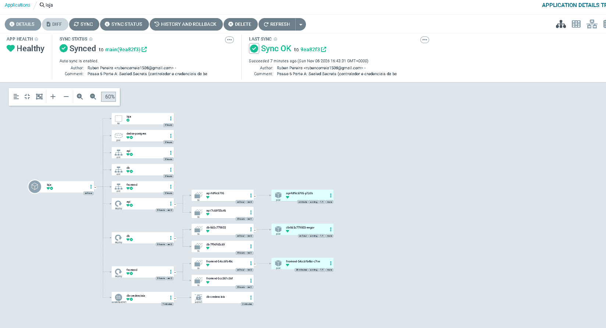
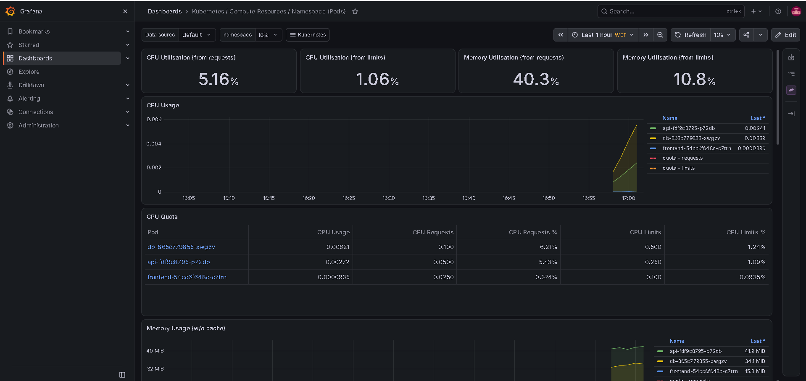
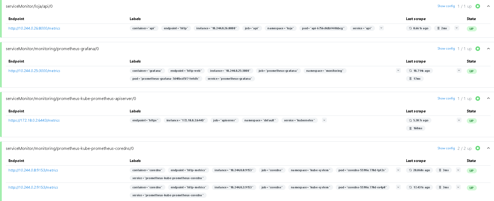
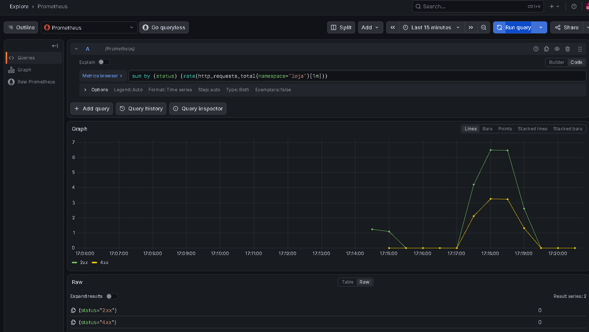

# Passo 06 – Segredos e observabilidade

**Objetivo:** pôr os segredos da loja no Git de forma segura (Sealed Secrets) e, a seguir, passar a ver o que se passa dentro da loja e do cluster (métricas, dashboards e logs).

**Partes deste passo:**

- A. Segredos no Git com Sealed Secrets ✅
- B. Prometheus e Grafana: métricas do cluster ✅
- C. Métricas da própria API ✅
- D. Logs centralizados com Loki, opcional (por fazer)
- E. Fecho (por fazer)

---

## 1. Teoria

### 1.1 O problema dos segredos no GitOps

Em GitOps o Git descreve tudo o que corre no cluster. Os Secrets do Kubernetes são a exceção: guardam os valores em **base64**, que é só uma forma de escrever o texto de outra maneira e se descodifica em segundos. Por isso um Secret normal **não pode** ir para o Git (e o repositório é público). Se o criarmos à mão, o Git deixa de descrever a plataforma toda e o cluster deixa de ser reprodutível.

### 1.2 Sealed Secrets

Usa **encriptação com duas chaves**:

- **Chave pública:** só serve para encriptar; pode ser conhecida por toda a gente.
- **Chave privada:** só serve para desencriptar; fica dentro do cluster e nunca sai de lá.

São duas peças:

| Peça | Onde corre | O que faz |
|---|---|---|
| **Controlador** | Dentro do cluster (`kube-system`) | Guarda a chave privada, vigia os `SealedSecret` e transforma cada um num Secret normal |
| **`kubeseal`** | No teu computador | Vai buscar a chave pública ao controlador e encripta o Secret, gerando um `SealedSecret` |

O fluxo completo:

```text
.env -> kubeseal (chave pública) -> SealedSecret (no Git) -> ArgoCD aplica -> controlador (chave privada) -> Secret "db-credenciais"
```

### 1.3 Âmbito: o SealedSecret fica preso ao nome e ao namespace

Por omissão (âmbito *strict*), um `SealedSecret` só é desencriptado com o **mesmo nome e no mesmo namespace** para que foi criado. Copiá-lo para outro nome ou namespace não funciona. É o comportamento seguro.

### 1.4 Limitação: a chave privada

Se o cluster for apagado, perde-se a chave privada e os `SealedSecret` que estão no Git deixam de poder ser desencriptados. Nesse caso volta-se a encriptar com a chave do cluster novo. Em produção faz-se cópia de segurança da chave (guardada fora do Git, nunca no repositório).

### 1.5 Observabilidade: métricas, logs e traces

Observar um sistema é conseguir perceber o que se passa lá dentro olhando para o que ele produz. Há três tipos de dados:

| Tipo | O que é | Exemplo na loja | Ferramenta |
|---|---|---|---|
| **Métricas** | Números ao longo do tempo | CPU do Pod `api`, pedidos por segundo, erros por minuto | Prometheus + Grafana |
| **Logs** | Linhas de texto que a aplicação escreve | "produto criado", uma mensagem de erro | Loki (Parte D) |
| **Traces** | O caminho de um pedido por vários serviços | Pedido do browser até à base de dados | Fora do âmbito |

### 1.6 Prometheus e Grafana

- O **Prometheus** funciona por *scraping*: de tempos a tempos faz um pedido HTTP a cada alvo (um endereço `/metrics`) e guarda os números com a hora. Não espera que lhe enviem dados, vai buscá-los.
- O **Grafana** não guarda métricas; lê-as do Prometheus e desenha gráficos (*dashboards*).
- O **Prometheus Operator** deixa configurar o Prometheus com recursos do Kubernetes. Um **ServiceMonitor** diz "recolhe as métricas deste Service" (vai ser preciso na Parte C, para a API).
- O **kube-state-metrics** transforma o estado dos objetos do Kubernetes (réplicas pedidas, Pods prontos, reinícios) em métricas.

---

## 2. Prática

### Parte A – Segredos no Git com Sealed Secrets ✅

**1. Instalar o controlador pelo ArgoCD.** O ficheiro `k8s/argocd/aplicacao-sealed-secrets.yaml` define uma Application cuja origem é um Helm chart. Instalar pelo ArgoCD (e não à mão com `helm install`) mantém tudo descrito no Git. Usa a versão 2.x do chart e dá ao controlador o nome `sealed-secrets-controller`, que é o que o `kubeseal` procura por omissão.

```powershell
kubectl apply -f k8s/argocd/aplicacao-sealed-secrets.yaml
kubectl get applications -n argocd
kubectl get pods -n kube-system -l app.kubernetes.io/name=sealed-secrets
```

**2. Instalar o `kubeseal` no computador.** Descarrega a versão igual à do controlador (a do `kubectl get deployment ... -o jsonpath` à imagem) e copia o `kubeseal.exe` para uma pasta **fora do repositório** (`C:\dev\ferramentas`), para o executável nunca ir para o Git.

```powershell
kubectl get deployment sealed-secrets-controller -n kube-system -o jsonpath="{.spec.template.spec.containers[0].image}"
C:\dev\ferramentas\kubeseal.exe --version
C:\dev\ferramentas\kubeseal.exe --fetch-cert
```

O `--fetch-cert` imprime a chave pública (`BEGIN CERTIFICATE`). Não é segredo.

**3. Gerar o SealedSecret a partir do `.env`**, sem gravar a palavra-passe em claro (o Secret é montado em memória, encriptado e só o resultado vai para o ficheiro):

```powershell
kubectl create secret generic db-credenciais --namespace loja --from-env-file=.env --dry-run=client -o yaml | C:\dev\ferramentas\kubeseal.exe --format yaml | Set-Content -Encoding ascii k8s\loja\05-db-credenciais-sealed.yaml
```

Usa-se `Set-Content -Encoding ascii` e não `>`, porque no PowerShell o `>` grava em UTF-16 e estraga o YAML. O ficheiro tem `kind: SealedSecret` e valores encriptados ilegíveis em `encryptedData`.

**4. Commit e push** do ficheiro. O ArgoCD aplica-o e o controlador tenta criar o Secret.

**5. O Secret manual já existe.** O controlador recusa-se a substituir um Secret que não criou:

```text
Status:
  Conditions:
    Message:  failed update: Resource "db-credenciais" already exists and is not managed by SealedSecret
    Status:   False
    Type:     Synced
Events:
  Warning  ErrUpdateFailed  3m55s (x6 over 3m55s)  sealed-secrets  Resource "db-credenciais" already exists and is not managed by SealedSecret
```

Na interface do ArgoCD, a `loja` ficou `Degraded` (mas `Synced`): o Git estava aplicado, só o `SealedSecret` estava com problema.

**6. Deixar o controlador assumir o Secret.** Apaga-se o Secret manual; o controlador recria-o a partir do Git. Como a tentativa anterior tinha falhado 6 vezes, ele demorou a reavaliar, e foi preciso forçar apagando o Pod do controlador (a chave privada não se perde: está guardada num Secret do `kube-system`).

```powershell
kubectl delete secret db-credenciais -n loja
kubectl delete pod -n kube-system -l app.kubernetes.io/name=sealed-secrets
kubectl get secret db-credenciais -n loja
kubectl get sealedsecret -n loja
```

```text
NAME             TYPE     DATA   AGE
db-credenciais   Opaque   3      7s

NAME             STATUS   SYNCED   AGE
db-credenciais            True     5m42s
```

**7. Provar que o Secret novo funciona.** Cria-se um Pod novo da API, que lê os valores do Secret recriado. A `/pronto` testa a ligação à base de dados, por isso `1/1` prova que as credenciais desencriptadas estão certas:

```powershell
kubectl delete pod -n loja -l app=api
kubectl get pods -n loja -w
```

```text
api-fdf9c8795-p72db         0/1     Running   0             6s
api-fdf9c8795-p72db         1/1     Running   0             7s
```

Na interface do ArgoCD a `loja` voltou a `Healthy`. A árvore mostra o `SealedSecret` (`db-credenciais`) ligado ao Secret que o controlador criou a partir dele:



**Nota sobre o arranque do cluster.** Ao religar o Docker, o `frontend` entrou em `CrashLoopBackOff`: o nginx só resolve o nome `api` no arranque, e o DNS do cluster (`coredns`) ainda estava a recuperar (`host not found in upstream "api"`). Resolveu-se apagando o Pod. Fica como melhoria futura configurar o nginx para resolver o nome em tempo de execução (diretiva `resolver`).

### Parte B – Prometheus e Grafana ✅

**O que se instalou.** O chart `kube-prometheus-stack`, pelo ArgoCD (como o Sealed Secrets), com o ficheiro `k8s/argocd/aplicacao-prometheus-grafana.yaml`. Traz o Prometheus, o Grafana, o Prometheus Operator e o kube-state-metrics, com dashboards já feitos para o cluster.

**Escolhas de configuração (cada uma está comentada no ficheiro):**

| Escolha | Porquê |
|---|---|
| `alertmanager` desligado | Não precisamos de alertas por email/Slack agora; poupa memória |
| `nodeExporter` desligado | No kind dentro do Docker Desktop costuma falhar ao arrancar (problema de montagem do sistema de ficheiros do nó). As métricas por contentor continuam a existir |
| `kubeEtcd`, `kubeControllerManager`, `kubeScheduler`, `kubeProxy` desligados | No kind não expõem métricas da forma esperada e apareciam "em baixo" sem estarem |
| `admissionWebhooks` e `tls` do operator desligados | Precisam de certificados e jobs auxiliares que complicam a instalação por ArgoCD; num laboratório local não compensa |
| `retention: 2d` | Os dados ficam num disco temporário; guardar pouco tempo chega |
| `serviceMonitorSelectorNilUsesHelmValues: false` | Faz o Prometheus ler ServiceMonitors de qualquer namespace; necessário na Parte C |
| Limites de memória em cada componente | A stack é pesada; os limites impedem-na de consumir o portátil todo |
| `ServerSideApply=true` e `CreateNamespace=true` | Os CRDs do chart são grandes demais para o `apply` normal; o namespace `monitoring` é criado se não existir |

**Passos:**

```powershell
kubectl apply -f k8s/argocd/aplicacao-prometheus-grafana.yaml
kubectl get applications -n argocd
kubectl get pods -n monitoring -w
```

A primeira instalação demorou cerca de 3 minutos (descarregar o chart e as imagens). A aplicação passou por `OutOfSync/Missing`, depois `Synced/Degraded` e `Synced/Progressing` e ficou `Synced/Healthy`. Os 4 Pods ficaram `Running`:

```text
prometheus-grafana-65b66d99d4-l6g2m                    3/3     Running   0          91s
prometheus-kube-prometheus-operator-5c46f599fc-mxbpc   1/1     Running   0          107s
prometheus-kube-state-metrics-5759bf56bb-9d87p         1/1     Running   0          107s
prometheus-prometheus-kube-prometheus-prometheus-0     2/2     Running   0          102s
```

**Observação: o Grafana reinicia quando o ArgoCD reprocessa o chart.** Durante a primeira sincronização apareceram três Pods do Grafana em sequência, e voltou a acontecer depois de aplicar a definição atualizada da Application (apareceu um Pod novo, `3/3` ao fim de cerca de 1 minuto, e o antigo foi terminado). O resto da stack não foi tocado. A causa provável é um valor gerado pelo chart em cada processamento; não foi confirmada. É inofensivo, mas fica anotado para observar se volta a acontecer sem mexer em nada.

**Fixar a versão do chart.** Na primeira instalação usou-se `targetRevision: "*"` (a mais recente). Para ver o que ficou:

```powershell
kubectl get application prometheus-grafana -n argocd -o jsonpath="{.status.sync.revision}"
```

Resultado: `93.1.0`. Substituiu-se o `"*"` por `"93.1.0"` no ficheiro e voltou-se a aplicar. Fixar a versão impede que uma atualização do chart mude a plataforma sem ninguém decidir. Os Pods do Prometheus, do operator e do kube-state-metrics não foram reiniciados.

**Abrir o Grafana:**

```powershell
kubectl port-forward svc/prometheus-grafana -n monitoring 3000:80
```

Em `http://localhost:3000`, utilizador `admin`. A palavra-passe inicial obtém-se do Secret `prometheus-grafana` (descodificando o `admin-password`), sem a escrever em lado nenhum.

**Decisão de segurança consciente:** a palavra-passe inicial deste chart é a mesma para toda a gente que o instala. O Grafana só é acessível por `port-forward` no computador local, por isso para um laboratório é aceitável. Em produção ficava num Secret próprio (um `SealedSecret`), o que se pode fazer na Parte E.

**Ver a loja:** em Dashboards, **Kubernetes / Compute Resources / Namespace (Pods)** com o namespace `loja`. Mostra a CPU e a memória de cada Pod. A tabela *CPU Quota* mostra os `requests` e `limits` definidos no Passo 5 (Parte C):

| Pod | CPU requests | CPU limits |
|---|---|---|
| `db` | 0.100 | 0.500 |
| `api` | 0.0500 | 0.250 |
| `frontend` | 0.0250 | 0.100 |

São exatamente os valores dos ficheiros YAML, o que mostra que o Kubernetes os aplicou e que o Prometheus os lê.



### Parte C – Métricas da própria API ✅

Até aqui o Prometheus só via o cluster (CPU, memória, Pods). Nesta parte a API passa a medir os **seus próprios pedidos**: quantos, com que código de resposta e quanto tempo demoram.

**O que mudou no código e nos ficheiros:**

| Ficheiro | Alteração | Porquê |
|---|---|---|
| `app/api/requirements.txt` | Nova biblioteca `prometheus-fastapi-instrumentator` | Mede cada pedido e publica os números |
| `app/api/main.py` | `Instrumentator(...).instrument(app).expose(app)` | Cria o endereço `/metrics`, que o Prometheus lê. Ficam de fora `/saude`, `/pronto` e `/metrics`, para as sondas do Kubernetes não encherem os gráficos com tráfego que não é de clientes |
| `k8s/loja/20-api.yaml` | Imagem `loja-api:0.2`; etiqueta `app: api` e nome `http` na porta do Service | O ServiceMonitor encontra o Service pela etiqueta e a porta pelo nome |
| `k8s/loja/25-api-servicemonitor.yaml` | Novo | Diz ao Prometheus que Service ler, em que porta e caminho, e de quanto em quanto tempo (15 s) |

**Passos:**

```powershell
docker build -t loja-api:0.2 ./app/api
kind load docker-image loja-api:0.2 --name plataforma
git add .
git commit -m "Passo 6 Parte C: metricas da API (Prometheus)"
git push
```

A imagem tem de estar no cluster **antes** do push; senão o ArgoCD pede uma imagem que o nó ainda não tem. Passados cerca de 3 minutos o ArgoCD ainda não tinha reagido (lê o Git de 3 em 3 minutos); forçou-se a leitura:

```powershell
kubectl annotate application loja -n argocd argocd.argoproj.io/refresh=hard --overwrite
```

Resultado: apareceu o ServiceMonitor `api` e um Pod `api` novo. O antigo manteve-se `1/1` até o novo ficar pronto (Rolling Update) e depois saiu:

```text
NAME                        READY   STATUS    RESTARTS      AGE
api-6756c8dbf4-8kbcg        1/1     Running   0             17s
db-865c779855-xwgzv         1/1     Running   1 (52m ago)   89m
frontend-54cc6f648c-c7trn   1/1     Running   0             50m
```

**Ver as métricas em bruto** (com `kubectl port-forward svc/api -n loja 8000:8000`):

```text
http_requests_total{handler="/produtos",method="GET",status="2xx"} 1.0
```

Significa: 1 pedido `GET /produtos` com resposta 2xx. É um **contador**: só aumenta (e volta a zero se o Pod reiniciar).

**O Prometheus recolhe a API.** Em `http://localhost:9090` (port-forward ao serviço `prometheus-kube-prometheus-prometheus`), **Status → Targets** mostra `serviceMonitor/loja/api/0` com **1/1 up**, a ler o Pod novo e a demorar cerca de 2 ms por leitura.



**Pedidos por segundo.** A consulta (em linguagem *PromQL*) é:

```text
sum by (status) (rate(http_requests_total{namespace="loja"}[1m]))
```

- `http_requests_total{namespace="loja"}`: o contador, só da loja.
- `rate(...[1m])`: quantos pedidos por segundo, calculado sobre o último minuto (a diferença do contador entre leituras).
- `sum by (status)`: soma por código de resposta, ficando uma linha por `2xx` e outra por `4xx`.

Gerou-se tráfego com 300 rondas de 3 pedidos (`/produtos`, `/produtos/1`, `/produtos/9999`): dois dão 200 e um dá 404.

**Observação: a linha `4xx` não apareceu na primeira ronda.** A API já tinha contado os 404 (`status="4xx"` com `60.0`), mas o gráfico só mostrava `2xx`. Motivo: o `rate` calcula a variação entre duas leituras, e a série `4xx` só nasceu com o primeiro 404, já com o valor 60. Sem leitura anterior não há variação para desenhar. Numa segunda ronda de tráfego a série já existia, subiu, e a linha apareceu. Conclusão prática: um contador novo só aparece num `rate` depois de variar.

**Resultado no Grafana** (Explore, fonte Prometheus, últimos 15 minutos): a linha `2xx` chega a cerca de 6,5 pedidos por segundo e a `4xx` a cerca de 3,3, ou seja, 2 respostas boas por cada 404, exatamente como o teste.



---

## 3. Registo do que fizeste

| Tarefa | Feito | Data | Notas |
|---|---|---|---|
| Cluster religado depois de parar o Docker | ✅ | 2026-11-08 | `frontend` precisou de ser recriado (DNS) |
| Controlador instalado pelo ArgoCD | ✅ | 2026-11-08 | Versão 0.41.2 |
| `kubeseal` instalado fora do repositório | ✅ | 2026-11-08 | `C:\dev\ferramentas` |
| `--fetch-cert` devolve a chave pública | ✅ | 2026-11-08 | |
| `SealedSecret` gerado e verificado (sem texto legível) | ✅ | 2026-11-08 | `k8s/loja/05-db-credenciais-sealed.yaml` |
| Commit e push do `SealedSecret` | ✅ | 2026-11-08 | |
| Erro "already exists" observado | ✅ | 2026-11-08 | `loja` ficou `Degraded` |
| Secret manual apagado e recriado pelo controlador | ✅ | 2026-11-08 | `SYNCED True` |
| Pod novo da API arranca com o Secret novo | ✅ | 2026-11-08 | `1/1` em 7 s |
| Print `passo-06-argocd-sealedsecret.png` | ✅ | 2026-11-08 | Cortado, sem email |
| Commit e push do doc da Parte A | ✅ | 2026-11-08 | |
| Application `prometheus-grafana` criada, 4 Pods `Running` | ✅ | 2026-11-08 | |
| Versão do chart fixada | ✅ | 2026-11-08 | `93.1.0` |
| Grafana acessível por `port-forward` | ✅ | 2026-11-08 | `http://localhost:3000` |
| Dashboard do namespace `loja` com dados | ✅ | 2026-11-08 | |
| Print `passo-06-grafana-loja.png` | ✅ | 2026-11-08 | |
| Commit e push da Parte B | ✅ | 2026-11-08 | |
| Imagem `loja-api:0.2` construída e carregada no cluster | ✅ | 2026-11-08 | |
| ServiceMonitor `api` criado pelo ArgoCD | ✅ | 2026-11-08 | |
| Alvo da API em `1/1 up` no Prometheus | ✅ | 2026-11-08 | |
| Gráfico de pedidos por código de resposta no Grafana | ✅ | 2026-11-08 | |
| Prints `passo-06-prometheus-target-api.png` e `passo-06-grafana-api.png` | ✅ | 2026-11-08 | |
| Commit e push do doc da Parte C | ✅ | 2026-11-08 | |

## 4. Para a entrevista

**Porque não se pode pôr um Secret do Kubernetes no Git?**
Os Secrets guardam os valores em base64, que é só uma codificação e se reverte em segundos. Quem tiver acesso ao repositório lê a palavra-passe.

**Como funcionam os Sealed Secrets?**
Um controlador no cluster guarda uma chave privada. A ferramenta `kubeseal` encripta o Secret com a chave pública e gera um `SealedSecret`, que pode ir para o Git. O controlador desencripta-o e cria o Secret normal. Só o cluster que tem a chave privada o consegue abrir.

**O que acontece se perderes a chave privada?**
Os `SealedSecret` no Git deixam de poder ser desencriptados e é preciso voltar a encriptar com a chave do cluster novo. Por isso em produção faz-se cópia de segurança da chave, fora do Git.

**Porque é que o controlador não substituiu o Secret que já existia?**
Por segurança: só gere Secrets que ele próprio criou, para não apagar por engano algo que não é seu.

**Qual a diferença entre métricas, logs e traces?**
Métricas são números ao longo do tempo (CPU, pedidos por segundo), logs são linhas de texto escritas pela aplicação e traces seguem um pedido por vários serviços.

**Como funciona o Prometheus?**
Por *scraping*: faz pedidos HTTP periódicos aos alvos (um endereço `/metrics`) e guarda os valores com a hora. O Grafana lê do Prometheus e desenha os gráficos.

**Porque fixaste a versão do Helm chart?**
Para que uma versão nova não seja instalada sem ninguém decidir. Na primeira instalação usei a mais recente, vi qual ficou e fixei-a.


**O que é um ServiceMonitor e porque é preciso?**
É um recurso do Prometheus Operator que descreve um alvo: que Service procurar (por etiqueta), em que porta e caminho ler as métricas e com que frequência. Sem ele o Prometheus não sabe que a API existe.

**O que faz o `rate()` e porque não se usa o contador diretamente?**
Um contador só aumenta, por isso o valor absoluto diz pouco. O `rate()` converte-o em variação por segundo, que é o que interessa (pedidos por segundo).

**Porque excluíste `/saude` e `/pronto` das métricas?**
Porque são pedidos do Kubernetes, não de clientes. Se contassem, os gráficos mostravam tráfego constante que não corresponde ao uso real da loja.