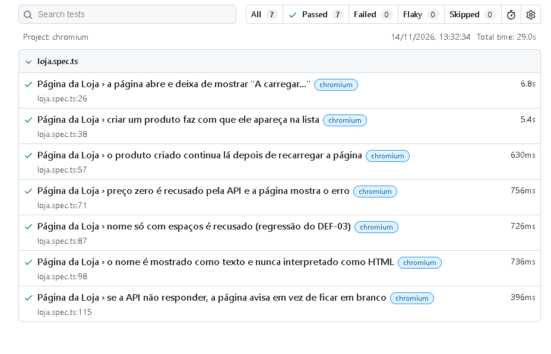

# Passo 08 – Testes E2E, desempenho, segurança, contratos e quality gates

**Objetivo:** subir na pirâmide de testes. No Passo 7 testámos a API sozinha; agora testamos a loja **como um todo** (browser), a sua **velocidade**, a sua **segurança** e os **acordos entre as suas peças**.

**Partes deste passo:**

- A. Testes ponta a ponta (E2E) com Playwright ✅
- B. Testes de desempenho com k6 (por fazer)
- C. Teste de segurança com OWASP ZAP (por fazer)
- D. Testes de contrato com Pact (por fazer)
- E. Quality gates (por fazer)

---

## 1. Teoria

### 1.1 Do que cada nível de teste trata

| Nível | Pergunta a que responde | Ferramenta | Parte |
|---|---|---|---|
| API (Passo 7) | A API responde bem a cada pedido? | pytest + httpx | feito |
| **E2E** | **Um utilizador consegue usar a loja no browser?** | **Playwright** | **A** |
| Desempenho | Quantos pedidos aguenta e com que tempos? | k6 | B |
| Segurança | Há vulnerabilidades comuns na aplicação a correr? | OWASP ZAP | C |
| Contrato | Frontend e API continuam a entender-se quando um deles muda? | Pact | D |
| Quality gates | Que critérios fazem uma alteração ser aceite ou recusada? | Regras na pipeline | E |

### 1.2 O que é um teste ponta a ponta (E2E)

Um teste E2E abre um **browser verdadeiro**, vai à página e usa-a como um utilizador: escreve nos campos, clica nos botões e verifica o que aparece no ecrã. Passa por todas as peças: nginx, frontend, API e base de dados.

**O que apanha que os testes da API não apanham:** problemas na ligação entre as peças. Por exemplo, o nginx a encaminhar mal para a API (o 502 do Passo 6) é invisível para os testes da API, que falam diretamente com ela, mas um teste E2E falharia logo.

**Desvantagem:** são lentos e frágeis (dependem de página, rede e browser). Pela pirâmide de testes, escrevem-se **poucos**, só para os caminhos que mais importam. Os detalhes (limites, tipos de erro) ficam nos testes da API, que são rápidos.

### 1.3 O que é o Playwright e como funciona

Biblioteca que controla um browser por código. Para este projeto:

- **Em Node.js** (`@playwright/test`): é a versão mais usada no mercado. Escolhida em vez da versão Python por isso, e para evitar dependências do Python ainda sem suporte para o Python 3.14.
- **Só com o Chromium:** um browser chega para provar os fluxos; vários browsers multiplicam o tempo sem acrescentar muito.
- **Espera automática:** antes de clicar ou ler, o Playwright espera que o elemento exista e esteja pronto. Evita os `sleep` que tornam os testes instáveis.
- **Locators:** a forma de apontar para elementos. Usamos os `data-testid` do `index.html`, que não dependem de textos ou estilos que possam mudar.
- **Provas de falha:** quando um teste falha, guarda captura de ecrã, vídeo e *trace* (gravação passo a passo).

### 1.4 Testes instáveis (flaky) e porque não usamos repetições

Um teste instável passa umas vezes e falha outras sem nada ter mudado. Repetir automaticamente (`retries`) esconde o problema, por isso está a `0`: se um teste falhar, queremos vê-lo e perceber a causa.

## 2. Prática

### Parte A – Testes E2E com Playwright ✅

#### A1. Estrutura criada

```text
tests/e2e/
├── package.json            # nome do projeto e atalhos (npm test)
├── package-lock.json       # versões exatas instaladas (criado pelo npm)
├── playwright.config.ts    # onde está a loja, que browser, o que guardar nas falhas
├── .gitignore              # não guarda node_modules nem relatórios
└── tests/
    └── loja.spec.ts        # os 7 testes
```

O endereço da loja vem da variável `BASE_URL` (por defeito `http://localhost:8081`, o cluster), tal como o `API_URL` no Passo 7. O mesmo teste corre contra o Compose (`BASE_URL=http://localhost:8080`) sem mudar código.

#### A2. Instalação

```powershell
cd C:\dev\Plataforma-cloud-qa\tests\e2e
npm install -D @playwright/test      # biblioteca (fica registada no package.json)
npx playwright install chromium      # o browser que os testes controlam
```

#### A3. Os 7 testes

| # | Teste | O que prova |
|---|---|---|
| 1 | A página abre e deixa de mostrar "A carregar..." | nginx, frontend e API ligados: a lista carrega |
| 2 | Criar um produto faz com que ele apareça na lista | Fluxo principal completo; preço formatado como `12,50 €`; formulário limpo depois |
| 3 | O produto criado continua lá depois de recarregar | Ficou mesmo guardado na base de dados (não só desenhado na página) |
| 4 | Preço zero é recusado e a página mostra o erro | O 422 da API chega ao utilizador como mensagem legível; nada é criado |
| 5 | Nome só com espaços é recusado | Regressão do DEF-03 vista pelo utilizador |
| 6 | O nome é mostrado como texto, nunca como HTML | Proteção contra XSS: `<b>nome</b>` aparece literal, sem criar elemento `<b>` |
| 7 | Se a API não responder, a página avisa | O Playwright corta o pedido de propósito; a página mostra a mensagem em vez de ficar em branco |

**Regras seguidas:**
- Cada teste usa um **nome único**, porque a API não tem `DELETE` e a base de dados guarda tudo.
- Os testes 5 e 6 reaproveitam casos do Passo 7 (nome só de espaços, injeção) mas pela página, que é um caminho diferente.
- O teste 7 só é possível com um browser: nem o pytest nem a API conseguem simular a falha vista pelo utilizador.

#### A4. Resultado (contra o cluster)

```text
Running 7 tests using 1 worker

  ✓  1 …gina da Loja › a página abre e deixa de mostrar "A carregar..." (6.8s)
  ✓  2 …ina da Loja › criar um produto faz com que ele apareça na lista (5.4s)
  ✓  3 …a › o produto criado continua lá depois de recarregar a página (630ms)
  ✓  4 …Loja › preço zero é recusado pela API e a página mostra o erro (756ms)
  ✓  5 …da Loja › nome só com espaços é recusado (regressão do DEF-03) (726ms)
  ✓  6 …da Loja › o nome é mostrado como texto e nunca interpretado como HTML (736ms)
  ✓  7 … a API não responder, a página avisa em vez de ficar em branco (396ms)

  7 passed (29.0s)
```

O primeiro teste demora mais (6,8 s) porque inclui o arranque do browser.

Relatório HTML (abre-se com `npx playwright show-report`):



#### A5. Erros e observações da Parte A

| O que aconteceu | Causa | Lição |
|---|---|---|
| `Error: No tests found` | O `loja.spec.ts` ficou em `tests\e2e\` e não em `tests\e2e\tests\`, que é a pasta onde o `playwright.config.ts` procura (`testDir`) | O Playwright só encontra testes na pasta configurada; confirmar a estrutura com `dir -Recurse` |
| O ficheiro `.gitignore` apareceu como `gitignore` | O ponto inicial perdeu-se ao copiar o ficheiro | Sem o ponto o Git não o usa e acabaria por guardar `node_modules` (centenas de ficheiros); renomeado com `Rename-Item` |
| O `npx playwright test` criou `playwright-report/` e `test-results/` mesmo sem testes | O Playwright cria estas pastas em cada execução | Estão no `.gitignore`, não vão para o Git |
| Aviso do npm sobre versão nova (11.16 → 12.2) | Há uma versão major do npm | Ignorado: não é necessário atualizar para este projeto |

## 3. Registo do que fizeste

| Tarefa | Estado | Data | Notas |
|---|---|---|---|
| Node e npm verificados | ✅ | 2026-11-14 | Node 24.18.0, npm 11.16.0 |
| Playwright e Chromium instalados | ✅ | 2026-11-14 | |
| Estrutura de ficheiros corrigida (pasta `tests`, `.gitignore`) | ✅ | 2026-11-14 | |
| A: 7 testes E2E a passar contra o cluster | ✅ | 2026-11-14 | `7 passed (29.0s)` |
| A: print do relatório guardado | ✅ | 2026-11-14 | `passo-08-playwright-relatorio.png` |
| A: commit e push | ☐ | | |
| B: testes de desempenho (k6) | ☐ | | |
| C: teste de segurança (ZAP) | ☐ | | |
| D: testes de contrato (Pact) | ☐ | | |
| E: quality gates | ☐ | | |

## 4. Para a entrevista

**Qual a diferença entre os testes da API e os testes E2E?**
Os da API enviam pedidos HTTP diretamente à API e verificam códigos e dados. Os E2E usam um browser verdadeiro, como um utilizador, e passam por todas as peças (nginx, frontend, API e base de dados). Apanham problemas na ligação entre peças que os testes da API não veem.

**Porque escreveste só 7 testes E2E?**
Pela pirâmide de testes: os de browser são lentos e frágeis. Cobrem só os caminhos principais e os riscos que só se veem na página. Os detalhes estão nos 52 testes da API, que correm em segundos.

**Como evitas testes instáveis?**
Uso a espera automática do Playwright em vez de pausas fixas, localizo elementos por `data-testid` (que não dependem de textos nem de estilos), dou a cada teste dados únicos e não uso repetições automáticas, para que um teste instável apareça em vez de ficar escondido.

**Como testaste o que acontece quando a API falha?**
O Playwright interceta o pedido de rede e corta-o de propósito. Verifico que a página mostra uma mensagem de erro em vez de ficar em branco.

**Como verificas que o produto ficou mesmo guardado?**
Recarrego a página depois de criar. Se o produto continua na lista, veio da base de dados e não apenas do ecrã.

**Como proteges contra XSS e como o testaste?**
O frontend insere os dados com `textContent` (e não `innerHTML`), por isso o browser trata-os como texto. O teste cria um produto com o nome `<b>…</b>` e verifica que as etiquetas aparecem literalmente e que não foi criado nenhum elemento `<b>`.
