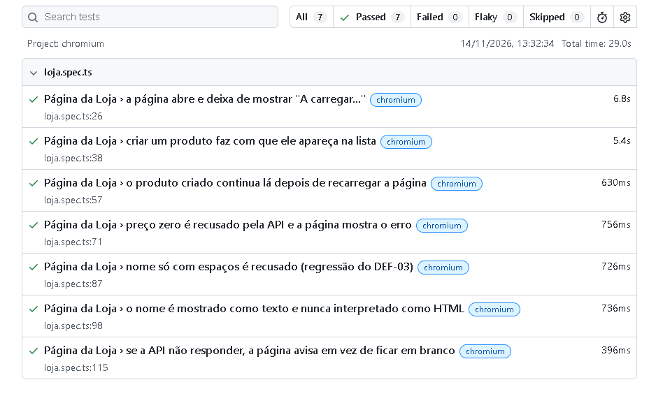

# Passo 08 – Testes E2E, desempenho, segurança, contratos e quality gates

**Objetivo:** subir na pirâmide de testes. No Passo 7 testámos a API sozinha; agora testamos a loja **como um todo** (browser), a sua **velocidade**, a sua **segurança** e os **acordos entre as suas peças**.

**Partes deste passo:**

- A. Testes ponta a ponta (E2E) com Playwright ✅
- B. Testes de desempenho com k6, com uma melhoria medida (antes e depois) ✅
- C. Teste de segurança com OWASP ZAP: 10 avisos encontrados, corrigidos e confirmados ✅ (o scan ativo, opcional, fica por fazer)
- D. Testes de contrato com Pact (por fazer)
- E. Quality gates (por fazer)

---

## 1. Teoria

### 1.1 Do que cada nível de teste trata

| Nível | Pergunta a que responde | Ferramenta | Parte |
|---|---|---|---|
| API (Passo 7) | A API responde bem a cada pedido? | pytest + httpx | feito |
| **E2E** | **Um utilizador consegue usar a loja no browser?** | **Playwright** | **A** |
| Desempenho | Quantos pedidos aguenta e com que tempos? | k6 | B |
| Segurança | Há vulnerabilidades comuns na aplicação a correr? | OWASP ZAP | C |
| Contrato | Frontend e API continuam a entender-se quando um deles muda? | Pact | D |
| Quality gates | Que critérios fazem uma alteração ser aceite ou recusada? | Regras na pipeline | E |

### 1.2 O que é um teste ponta a ponta (E2E)

Um teste E2E abre um **browser verdadeiro**, vai à página e usa-a como um utilizador: escreve nos campos, clica nos botões e verifica o que aparece no ecrã. Passa por todas as peças: nginx, frontend, API e base de dados.

**O que apanha que os testes da API não apanham:** problemas na ligação entre as peças. Por exemplo, o nginx a encaminhar mal para a API (o 502 do Passo 6) é invisível para os testes da API, que falam diretamente com ela, mas um teste E2E falharia logo.

**Desvantagem:** são lentos e frágeis (dependem de página, rede e browser). Pela pirâmide de testes, escrevem-se **poucos**, só para os caminhos que mais importam. Os detalhes (limites, tipos de erro) ficam nos testes da API, que são rápidos.

### 1.3 O que é o Playwright e como funciona

Biblioteca que controla um browser por código. Para este projeto:

- **Em Node.js** (`@playwright/test`): é a versão mais usada no mercado. Escolhida em vez da versão Python por isso, e para evitar dependências do Python ainda sem suporte para o Python 3.14.
- **Só com o Chromium:** um browser chega para provar os fluxos; vários browsers multiplicam o tempo sem acrescentar muito.
- **Espera automática:** antes de clicar ou ler, o Playwright espera que o elemento exista e esteja pronto. Evita os `sleep` que tornam os testes instáveis.
- **Locators:** a forma de apontar para elementos. Usamos os `data-testid` do `index.html`, que não dependem de textos ou estilos que possam mudar.
- **Provas de falha:** quando um teste falha, guarda captura de ecrã, vídeo e *trace* (gravação passo a passo).

### 1.4 Testes instáveis (flaky) e porque não usamos repetições

Um teste instável passa umas vezes e falha outras sem nada ter mudado. Repetir automaticamente (`retries`) esconde o problema, por isso está a `0`: se um teste falhar, queremos vê-lo e perceber a causa.

### 1.5 O que é um teste de desempenho

Os outros testes verificam se a loja **funciona**. Este verifica **como se comporta com muita gente a usá-la ao mesmo tempo**: quão depressa responde e a partir de que carga começa a falhar. Uma API pode passar em todos os testes funcionais e demorar 5 segundos a responder quando há 50 utilizadores.

### 1.6 Conceitos

| Termo | O que é |
|---|---|
| **VU (utilizador virtual)** | Um utilizador simulado que repete em ciclo o que lhe mandam fazer. 20 VUs = 20 utilizadores em simultâneo. |
| **Latência** | Tempo entre enviar o pedido e receber a resposta completa. |
| **Throughput** | Pedidos atendidos por segundo (req/s). |
| **Taxa de erros** | Percentagem de pedidos que falham. |
| **Percentil (p95, p99)** | O p95 é o tempo abaixo do qual ficam 95 % dos pedidos. |
| **Threshold (limiar)** | Regra de aprovação escrita no teste (por exemplo, p95 abaixo de 300 ms). Se for violada, o k6 termina com falha. É a base dos quality gates. |

**Porque percentil e não média:** a média esconde os casos maus. Se 99 pedidos demoram 50 ms e 1 demora 5 s, a média parece boa, mas alguém esperou 5 segundos. O p95 e o p99 mostram esses casos.

### 1.7 Tipos de teste de desempenho

| Tipo | O que faz | Pergunta | Neste projeto |
|---|---|---|---|
| Fumo | 1 VU, pouco tempo | O teste e o sistema funcionam? | feito |
| Carga | Carga normal esperada | Aguenta o dia a dia dentro dos limites? | feito |
| Esforço (stress) | Carga a subir além do esperado | Onde está o limite e como falha? | feito |
| Pico (spike) | Subida súbita | Recupera de um pico? | não (o cluster corre num portátil) |
| Duração (soak) | Carga normal durante horas | Há degradação lenta? | não |

### 1.8 O k6 e cuidados deste projeto

O **k6** é uma ferramenta de código aberto da Grafana Labs. O teste escreve-se em JavaScript (corre no próprio k6, não em Node), descreve o que cada VU faz e os thresholds, e no fim mostra as métricas.

- **Fala com o nginx, sem browser:** `k6 → nginx (8081) → API → base de dados`. Como não usa browser, simula dezenas de utilizadores com pouca memória.
- **Os resultados valem para este computador**, não para produção: o cluster corre em Docker Desktop e o k6 corre no mesmo PC, a disputar o mesmo CPU. Servem para **comparar antes e depois**.
- **Só leituras (GET):** a API não tem `DELETE`, por isso milhares de `POST` encheriam a base de dados de lixo para sempre.

### 1.9 O que é um teste de segurança de aplicações

Procura **vulnerabilidades**: falhas que alguém mal-intencionado poderia explorar. A referência do setor é o **OWASP Top 10**, a lista das categorias de falhas mais comuns em aplicações web (injeção de código, configuração insegura, controlo de acessos fraco, etc.).

| Modo | O que analisa | Neste projeto |
|---|---|---|
| **SAST** (análise estática) | O código e a configuração, **sem correr** a aplicação | Scans do Passo 4 (pipeline, parada) |
| **DAST** (análise dinâmica) | A aplicação **a correr**, de fora, como um atacante | **ZAP (Parte C)** |

### 1.10 O OWASP ZAP

Ferramenta gratuita de DAST. Corre em Docker (imagem `ghcr.io/zaproxy/zaproxy:stable`), por isso não se instala nada no Windows.

| Script | O que faz | Risco para a aplicação |
|---|---|---|
| `zap-baseline.py` | **Passivo:** navega, observa as respostas e aponta problemas; não envia ataques | Baixo (mas ver a nota abaixo) |
| `zap-api-scan.py` | Lê a descrição OpenAPI e testa os endpoints | Pode enviar pedidos de ataque |
| `zap-full-scan.py` | **Ativo:** envia pedidos maliciosos de propósito | Alto: cria dados, pode partir coisas |

**Nota importante:** o baseline com `-j` (AJAX spider) **não é totalmente inofensivo**. O spider abre a página num browser, preenche o formulário sozinho e clica em "Criar produto", o que cria produtos na base de dados. Foi o que se viu (ver C2).

### 1.11 Cabeçalhos de segurança que o nginx deve enviar

| Cabeçalho | O que faz |
|---|---|
| `X-Content-Type-Options: nosniff` | O browser não "adivinha" o tipo de um ficheiro (impede que texto seja tratado como script) |
| `X-Frame-Options: DENY` | Impede que a página seja metida dentro de outra (*clickjacking*: enganar cliques) |
| `Content-Security-Policy` (CSP) | Diz ao browser de onde pode vir o código e os pedidos; limita muito o estrago de um XSS |
| `Referrer-Policy` | Controla o que se revela a outros sites ao seguir um link |
| `Permissions-Policy` | Desliga funcionalidades do browser que a aplicação não usa (câmara, localização) |
| `Cross-Origin-Opener/Embedder/Resource-Policy` | Isolamento entre origens |
| `server_tokens off` (nginx) | Não revelar a versão do servidor, que ajuda a procurar falhas conhecidas |

### 1.12 Porque uma CSP estrita obrigou a mexer na página

Uma CSP sem `unsafe-inline` proíbe CSS e JavaScript escritos **dentro do HTML**, que é por onde entra código injetado num XSS. Por isso o `<style>` e o `<script>` do `index.html` passaram para ficheiros próprios (`estilo.css` e `app.js`), e a CSP pode dizer "só aceito código que venha deste servidor", sem exceções.

### 1.13 Falsos positivos

Um scanner automático nem sempre tem razão. Cada aviso tem de ser interpretado antes de ser "corrigido": pode ser um problema real, uma informação sem ação necessária, ou um falso positivo.

## 2. Prática

### Parte A – Testes E2E com Playwright ✅

#### A1. Estrutura criada

```text
tests/e2e/
├── package.json            # nome do projeto e atalhos (npm test)
├── package-lock.json       # versões exatas instaladas (criado pelo npm)
├── playwright.config.ts    # onde está a loja, que browser, o que guardar nas falhas
├── .gitignore              # não guarda node_modules nem relatórios
└── tests/
    └── loja.spec.ts        # os 7 testes
```

O endereço da loja vem da variável `BASE_URL` (por defeito `http://localhost:8081`, o cluster), tal como o `API_URL` no Passo 7. O mesmo teste corre contra o Compose (`BASE_URL=http://localhost:8080`) sem mudar código.

#### A2. Instalação

```powershell
cd C:\dev\Plataforma-cloud-qa\tests\e2e
npm install -D @playwright/test      # biblioteca (fica registada no package.json)
npx playwright install chromium      # o browser que os testes controlam
```

#### A3. Os 7 testes

| # | Teste | O que prova |
|---|---|---|
| 1 | A página abre e deixa de mostrar "A carregar..." | nginx, frontend e API ligados: a lista carrega |
| 2 | Criar um produto faz com que ele apareça na lista | Fluxo principal completo; preço formatado como `12,50 €`; formulário limpo depois |
| 3 | O produto criado continua lá depois de recarregar | Ficou mesmo guardado na base de dados (não só desenhado na página) |
| 4 | Preço zero é recusado e a página mostra o erro | O 422 da API chega ao utilizador como mensagem legível; nada é criado |
| 5 | Nome só com espaços é recusado | Regressão do DEF-03 vista pelo utilizador |
| 6 | O nome é mostrado como texto, nunca como HTML | Proteção contra XSS: `<b>nome</b>` aparece literal, sem criar elemento `<b>` |
| 7 | Se a API não responder, a página avisa | O Playwright corta o pedido de propósito; a página mostra a mensagem em vez de ficar em branco |

**Regras seguidas:**
- Cada teste usa um **nome único**, porque a API não tem `DELETE` e a base de dados guarda tudo.
- Os testes 5 e 6 reaproveitam casos do Passo 7 (nome só de espaços, injeção) mas pela página, que é um caminho diferente.
- O teste 7 só é possível com um browser: nem o pytest nem a API conseguem simular a falha vista pelo utilizador.

#### A4. Resultado (contra o cluster)

```text
Running 7 tests using 1 worker

  ✓  1 …gina da Loja › a página abre e deixa de mostrar "A carregar..." (6.8s)
  ✓  2 …ina da Loja › criar um produto faz com que ele apareça na lista (5.4s)
  ✓  3 …a › o produto criado continua lá depois de recarregar a página (630ms)
  ✓  4 …Loja › preço zero é recusado pela API e a página mostra o erro (756ms)
  ✓  5 …da Loja › nome só com espaços é recusado (regressão do DEF-03) (726ms)
  ✓  6 …da Loja › o nome é mostrado como texto e nunca interpretado como HTML (736ms)
  ✓  7 … a API não responder, a página avisa em vez de ficar em branco (396ms)

  7 passed (29.0s)
```

O primeiro teste demora mais (6,8 s) porque inclui o arranque do browser.

Relatório HTML (abre-se com `npx playwright show-report`):



#### A5. Erros e observações da Parte A

| O que aconteceu | Causa | Lição |
|---|---|---|
| `Error: No tests found` | O `loja.spec.ts` ficou em `tests\e2e\` e não em `tests\e2e\tests\`, que é a pasta onde o `playwright.config.ts` procura (`testDir`) | O Playwright só encontra testes na pasta configurada; confirmar a estrutura com `dir -Recurse` |
| O ficheiro `.gitignore` apareceu como `gitignore` | O ponto inicial perdeu-se ao copiar o ficheiro | Sem o ponto o Git não o usa e acabaria por guardar `node_modules` (centenas de ficheiros); renomeado com `Rename-Item` |
| O `npx playwright test` criou `playwright-report/` e `test-results/` mesmo sem testes | O Playwright cria estas pastas em cada execução | Estão no `.gitignore`, não vão para o Git |
| Aviso do npm sobre versão nova (11.16 → 12.2) | Há uma versão major do npm | Ignorado: não é necessário atualizar para este projeto |

### Parte B – Testes de desempenho com k6 ✅

#### B1. Instalação

```powershell
winget install k6 --source winget   # k6 v2.4.0
```

Depois de instalar, é preciso abrir um **terminal novo** para o Windows reconhecer o comando `k6`.

#### B2. Os três testes (`tests/k6/`)

| Ficheiro | Tipo | O que faz | Aprovação (thresholds) |
|---|---|---|---|
| `00-fumo.js` | Fumo | 1 VU durante 10 s | erros < 1 %, p95 < 500 ms, todos os checks |
| `10-carga.js` | Carga | Sobe a 10 VUs em 30 s, mantém 1 min, desce em 15 s | erros < 1 %, p95 < 300 ms, checks > 99 % |
| `20-esforco.js` | Esforço | 10 → 30 → 60 → 100 VUs, 30 s cada, desce em 20 s | erros < 5 % (aborta se passar), p95 < 1 s (informativo) |

O endereço vem de `BASE_URL` (por defeito `http://localhost:8081`, o cluster). O teste de esforço tem `abortOnFail` nos erros: se mais de 5 % falharem, o k6 pára sozinho para não deixar o cluster do PC em apuros.

#### B3. Resultado do teste de fumo

```text
  █ THRESHOLDS

    checks
    ✓ 'rate==1' rate=100.00%

    http_req_duration
    ✓ 'p(95)<500' p(95)=18.66ms

    http_req_failed
    ✓ 'rate<0.01' rate=0.00%

  █ TOTAL RESULTS

    checks_total.......: 30      2.933941/s
    checks_succeeded...: 100.00% 30 out of 30
    checks_failed......: 0.00%   0 out of 30

    ✓ /api/saude responde 200
    ✓ /api/produtos responde 200
    ✓ /api/produtos devolve uma lista

    HTTP
    http_req_duration..............: avg=9.24ms min=2.23ms med=9.06ms max=18.67ms p(90)=18.57ms p(95)=18.66ms
    http_req_failed................: 0.00%  0 out of 20
    http_reqs......................: 20     1.955961/s

    EXECUTION
    iteration_duration.............: avg=1.02s  min=1.01s  med=1.01s  max=1.06s   p(90)=1.02s   p(95)=1.04s
    iterations.....................: 10     0.97798/s
    vus............................: 1      min=1       max=1
```

**Como se lê:** cada ciclo tem 3 verificações e 2 pedidos, e correu 10 vezes (30 checks, 20 pedidos), todos bem. Os pedidos demoram milissegundos; os ~1,02 s de cada ciclo vêm do `sleep(1)`, que simula a pausa de um utilizador real. Ponto de partida: **p95 de 18,66 ms com 1 utilizador**.

#### B4. Resultado do teste de carga (10 utilizadores)

```text
  █ THRESHOLDS

    checks
    ✓ 'rate>0.99' rate=100.00%

    http_req_duration
    ✓ 'p(95)<300' p(95)=17.53ms

    http_req_failed
    ✓ 'rate<0.01' rate=0.00%

  █ TOTAL RESULTS

    checks_total.......: 1120    10.564633/s
    checks_succeeded...: 100.00% 1120 out of 1120
    checks_failed......: 0.00%   0 out of 1120

    ✓ página responde 200
    ✓ lista responde 200
    ✓ lista é um array
    ✓ saúde responde 200

    HTTP
    http_req_duration..............: avg=6.45ms min=0s    med=3.31ms max=36.2ms p(90)=14.75ms p(95)=17.53ms
    http_req_failed................: 0.00%  0 out of 840
    http_reqs......................: 840    7.923474/s

    EXECUTION
    iteration_duration.............: avg=3.02s  min=3.01s med=3.01s  max=3.04s  p(90)=3.02s   p(95)=3.02s
    iterations.....................: 280    2.641158/s
    vus_max........................: 10     min=10       max=10
```

**Como se lê:** 280 ciclos × 4 verificações = 1120 checks e 280 × 3 pedidos = 840 pedidos, todos bem. Com 10 utilizadores os tempos ficaram praticamente iguais aos de 1 utilizador (p95 de 17,53 ms contra 18,66 ms), o que mostra que a esta carga a loja não sofre nada. O `min=0s` vem da pouca resolução do relógio do Windows, que arredonda pedidos muito rápidos para zero; não é um erro. O teste de carga **não encontra o limite**: 10 utilizadores com pausas de 1 s geram só ~8 pedidos por segundo.

#### B5. Resultado do teste de esforço, com 1 réplica da API (antes)

```text
  █ THRESHOLDS

    http_req_duration
    ✗ 'p(95)<1000' p(95)=3.79s

    http_req_failed
    ✓ 'rate<0.05' rate=0.39%

  █ TOTAL RESULTS

    checks_total.......: 3065   21.8278/s
    checks_succeeded...: 99.60% 3053 out of 3065
    checks_failed......: 0.39%  12 out of 3065

    ✗ lista responde 200
      ↳  99% — ✓ 3053 / ✗ 12

    HTTP
    http_req_duration..............: avg=1.31s min=640.8µs  med=1.08s max=24.1s p(90)=2.79s p(95)=3.79s
    http_req_failed................: 0.39%  12 out of 3065
    http_reqs......................: 3065   21.8278/s

    EXECUTION
    iteration_duration.............: avg=1.81s min=500.88ms med=1.58s max=24.6s p(90)=3.29s p(95)=4.29s
    iterations.....................: 3065   21.8278/s
    vus_max........................: 100    min=100        max=100

ERRO[0140] thresholds on metrics 'http_req_duration' have been crossed
```

O `ERRO ... thresholds have been crossed` não é um erro do teste: é o k6 a dizer que o limiar informativo do p95 foi ultrapassado, que é o que um teste de esforço serve para mostrar. O teste **não abortou** porque os erros ficaram abaixo de 5 %.

**O que se observou:**
- A loja não partiu, mas ficou muito lenta: p95 de 3,79 s (mais de 200 vezes pior que no teste de carga) e um pedido que demorou 24,1 s.
- Durante o teste, o Pod `api` passou de `1/1` a `0/1` e voltou a `1/1` **sem aumentar os reinícios** (continuaram 2). Não foi um crash: a *readiness probe* (`/pronto`, com `timeout=2s`) demorou mais de 2 s a responder sob carga e o Kubernetes retirou o Pod do Service durante uns segundos. É provável (hipótese, não verificada) que os 12 pedidos falhados e o de 24 s tenham sido desse intervalo.

#### B6. Diagnóstico

```text
Replicas:               1 desired | 1 updated | 1 total | 1 available | 0 unavailable
      cpu:     250m          (limite)
      memory:  256Mi         (limite)
      cpu:      50m          (pedido)
      memory:   64Mi         (pedido)
    Liveness:   http-get http://:8000/saude delay=10s timeout=2s period=10s #success=1 #failure=3
    Readiness:  http-get http://:8000/pronto delay=3s timeout=2s period=5s #success=1 #failure=3

app\api\Dockerfile:54:CMD ["uvicorn", "main:app", "--host", "0.0.0.0", "--port", "8000"]
```

| O que mostra | Consequência |
|---|---|
| 1 réplica | Um só Pod atende todos os pedidos |
| `uvicorn` sem `--workers` | Um só processo Python dentro desse Pod |
| Limite de CPU de 250m (um quarto de núcleo) | O Kubernetes trava o Pod se tentar usar mais |
| Readiness com `timeout=2s` e 3 falhas | Se `/pronto` demorar mais de 2 s, o Pod sai do Service |

**Hipótese:** com 100 utilizadores, um só processo limitado a um quarto de núcleo ficou saturado e os pedidos ficaram em fila.

#### B7. A experiência: uma variável de cada vez

Mudou-se **uma só coisa**: `replicas: 1` → `replicas: 2` em `k8s/loja/20-api.yaml` (sem alterar código nem imagem; o ArgoCD aplicou a mudança). Mudar uma só variável é o que torna a comparação válida e o resultado dizia-nos onde estava o estrangulamento: se os tempos baixassem para cerca de metade, era a API; se quase não mudassem, estava noutro sítio (por exemplo, a base de dados).

#### B8. Resultado do teste de esforço, com 2 réplicas da API (depois)

```text
  █ THRESHOLDS

    http_req_duration
    ✗ 'p(95)<1000' p(95)=2.63s

    http_req_failed
    ✓ 'rate<0.05' rate=0.00%

  █ TOTAL RESULTS

    checks_total.......: 4971    35.415361/s
    checks_succeeded...: 100.00% 4971 out of 4971
    checks_failed......: 0.00%   0 out of 4971

    ✓ lista responde 200

    HTTP
    http_req_duration..............: avg=617.71ms min=9.62ms   med=157.23ms max=3.73s p(90)=2.09s p(95)=2.63s
    http_req_failed................: 0.00%  0 out of 4971
    http_reqs......................: 4971   35.415361/s

    EXECUTION
    iteration_duration.............: avg=1.11s    min=509.99ms med=657.82ms max=4.23s p(90)=2.59s p(95)=3.13s
    iterations.....................: 4971   35.415361/s
    vus_max........................: 100    min=100       max=100
```

#### B9. Comparação antes e depois

| | 1 réplica | 2 réplicas | Variação |
|---|---|---|---|
| Mediana | 1,08 s | 157 ms | -85 % |
| Média | 1,31 s | 618 ms | -53 % |
| p95 | 3,79 s | 2,63 s | -31 % |
| Pedido mais lento | 24,1 s | 3,73 s | -85 % |
| Erros | 0,39 % (12 pedidos) | 0 % | desapareceram |
| Pedidos por segundo | 21,8 | 35,4 | +62 % |
| Pedidos atendidos | 3065 | 4971 | +62 % |

**Conclusões:**
- **A API era mesmo um estrangulamento:** a mediana caiu 85 %, os erros desapareceram e o pior caso passou de 24 s para menos de 4 s.
- **Mas não era o único:** dobrar as réplicas deu +62 % de capacidade (e não +100 %), e o p95 continua a 2,63 s, acima do limiar de 1 s. Quando um recurso deixa de ser o limite, o seguinte aparece. Candidatos, **por confirmar**: a base de dados (um só Pod, e cada pedido lê a tabela inteira), o nginx (uma só réplica) e o próprio PC (o k6, o cluster e o Docker disputam o mesmo CPU).
- **Decisão:** manter 2 réplicas (melhora o desempenho e a disponibilidade, o que interessa para o chaos testing do Passo 9) e deixar a procura do estrangulamento seguinte como melhoria futura.

**Para os quality gates (Parte E):** os limiares do teste de **carga** (p95 < 300 ms, erros < 1 %) são adequados para uma pipeline. O limiar do teste de esforço (p95 < 1 s) falha de propósito; serve para mostrar o limite, não para aprovar ou recusar alterações.

#### B10. Erros e observações da Parte B

| O que aconteceu | Causa | Lição |
|---|---|---|
| `k6 : The term 'k6' is not recognized` | O Windows só reconhece o comando num terminal aberto depois da instalação | Abrir um terminal novo |
| `min=0s` nos tempos | Resolução do relógio do Windows arredonda pedidos muito rápidos | Não é um erro; o k6 continua a medir bem os restantes |
| `ERRO ... thresholds have been crossed` no teste de esforço | O limiar informativo do p95 foi ultrapassado | É o resultado esperado de um teste de esforço, não um erro do teste |
| Pod `api` `0/1` → `1/1` sem reiniciar durante a carga | A readiness probe excedeu o `timeout=2s` e o Pod saiu do Service por instantes | Sob carga, as sondas também são afetadas; reflexo do desenho do Passo 5 |
| Dobrar as réplicas não dobrou a capacidade | Há outro estrangulamento (por identificar) | Medir antes de otimizar, e mudar uma variável de cada vez |

### Parte C – Teste de segurança com OWASP ZAP ✅

#### C1. Comando do scan baseline

```powershell
docker pull ghcr.io/zaproxy/zaproxy:stable
mkdir C:\dev\Plataforma-cloud-qa\tests\zap -Force
cd C:\dev\Plataforma-cloud-qa\tests\zap
docker run --rm -v ${PWD}:/zap/wrk/:rw -t ghcr.io/zaproxy/zaproxy:stable zap-baseline.py -t http://host.docker.internal:8081 -j -r baseline-1-antes.html -J baseline-1-antes.json
```

- `host.docker.internal` é o nome que o contentor do ZAP usa para chegar ao Windows (onde está a porta 8081 do cluster).
- `-j` ativa o AJAX spider: a página pede os produtos com JavaScript e o spider normal não veria esses pedidos.
- `-v ${PWD}:/zap/wrk/:rw` monta a pasta atual, onde o ZAP escreve os relatórios (**por isso é preciso estar em `tests\zap` ao correr**).
- Código de saída: `0` tudo bem, `1` falhas, `2` só avisos. Um valor diferente de 0 não quer dizer que o scan correu mal.

#### C2. Resultado do scan "antes" (cluster, frontend 0.3)

```text
Using the Automation Framework
Total of 8 URLs
(58 regras PASS, lista omitida)
WARN-NEW: In Page Banner Information Leak [10009] x 3
WARN-NEW: Missing Anti-clickjacking Header [10020] x 3
WARN-NEW: X-Content-Type-Options Header Missing [10021] x 5
WARN-NEW: Server Leaks Version Information via "Server" HTTP Response Header Field [10036] x 5
WARN-NEW: Content Security Policy (CSP) Header Not Set [10038] x 4
WARN-NEW: Non-Storable Content [10049] x 6
WARN-NEW: Permissions Policy Header Not Set [10063] x 5
WARN-NEW: Source Code Disclosure - SQL [10099] x 1
WARN-NEW: Modern Web Application [10109] x 3
WARN-NEW: Cross-Origin-Embedder-Policy Header Missing or Invalid [90004] x 10
FAIL-NEW: 0     FAIL-INPROG: 0  WARN-NEW: 10    WARN-INPROG: 0  INFO: 0 IGNORE: 0     PASS: 58
```

Código de saída: `2` (só avisos).

**Correção ao que se tinha dito antes do scan:** afirmou-se que o baseline não sujaria a base de dados. Os resultados mostram o contrário:

```text
http://host.docker.internal:8081/?nome=ZAP&preco=1 (200 OK)
http://host.docker.internal:8081/api/produtos (201 Created)
```

O AJAX spider preencheu o formulário com `nome=ZAP` e `preco=1` e clicou em "Criar produto". Foi criado pelo menos um produto na base de dados do cluster e, como a API não tem `DELETE`, fica lá. É inofensivo, mas o scan "passivo" não é totalmente passivo quando o spider interage com formulários.

#### C3. Interpretação dos 10 avisos

| Aviso | O que é | Decisão |
|---|---|---|
| Anti-clickjacking em falta [10020] | A página podia ser metida dentro de outra para enganar cliques | Corrigir (`X-Frame-Options`, CSP `frame-ancestors`) |
| X-Content-Type-Options em falta [10021] | O browser pode "adivinhar" o tipo de ficheiro | Corrigir (`nosniff`) |
| CSP em falta [10038] | Nada diz ao browser de onde o código pode vir | Corrigir |
| Permissions Policy em falta [10063] | Funcionalidades do browser não estão desligadas | Corrigir |
| COEP em falta [90004] | Isolamento entre origens | Corrigir (COOP, COEP e CORP) |
| Servidor revela a versão [10036] e banner na página [10009] | O nginx diz a versão nas respostas e nas páginas 404 | Corrigir (`server_tokens off`) |
| Source Code Disclosure – SQL [10099] | O ZAP viu texto de SQL na resposta de `/api/produtos` | **Provável falso positivo** (ver abaixo) |
| Non-Storable Content [10049] | As respostas não ficam em cache | Sem ação: é o esperado numa API |
| Modern Web Application [10109] | A página usa JavaScript | Sem ação: é informativo |

**O falso positivo do SQL (hipótese, não verificada):** no Passo 7, o teste de injeção de SQL criou um produto cujo nome é um texto de SQL (a API guarda-o como texto, o comportamento correto). Esse nome aparece na lista de produtos, e o ZAP, ao ler a resposta, terá achado que a API revelava SQL. Não é código a ser revelado, são dados nossos. Para confirmar:

```powershell
(curl.exe -s http://localhost:8081/api/produtos | ConvertFrom-Json) | Where-Object { $_.nome -match "ZAP|DROP|SELECT|--" } | Format-Table
```

#### C4. A correção

**`app/frontend/nginx.conf`:** `server_tokens off` e os cabeçalhos de segurança do ponto 1.11. Usam `always` para serem enviados também nas respostas de erro. O nginx só herda estes cabeçalhos numa `location` sem `add_header` próprios (a `/healthz` tem um e por isso não os recebe, o que não faz mal).

CSP aplicada:

```text
default-src 'self'; script-src 'self'; style-src 'self'; img-src 'self' data:; connect-src 'self'; base-uri 'self'; form-action 'self'; frame-ancestors 'none'
```

**Ficheiros do frontend:** o CSS e o JavaScript saíram do `index.html` para `estilo.css` e `app.js` (o código é o mesmo). O `index.html` passou a usar `<link rel="stylesheet" href="estilo.css">` e `<script src="app.js" defer>`; o `defer` faz o script correr só depois de a página estar carregada. O Dockerfile copia os três ficheiros e a imagem sobe para `loja-frontend:0.4` (`30-frontend.yaml`).

Publicação (por esta ordem, como sempre: construir e carregar a imagem antes do push):

```powershell
docker build -t loja-frontend:0.4 ./app/frontend
kind load docker-image loja-frontend:0.4 --name plataforma
git add app k8s tests/zap
git commit -m "Passo 8 Parte C: cabeçalhos de segurança no nginx e CSS/JS fora do HTML (frontend 0.4)"
git push                                                # commit 7dffc3a
kubectl annotate application loja -n argocd argocd.argoproj.io/refresh=hard --overwrite
```

Rolling Update observado: o Pod `frontend-577b7b9797-ss9nd` ficou `1/1` em 8 s e só depois o antigo passou a `Terminating`.

#### C5. Verificação dos cabeçalhos

```text
HTTP/1.1 200 OK
Server: nginx
Content-Type: text/html
X-Content-Type-Options: nosniff
X-Frame-Options: DENY
Content-Security-Policy: default-src 'self'; script-src 'self'; style-src 'self'; img-src 'self' data:; connect-src 'self'; base-uri 'self'; form-action 'self'; frame-ancestors 'none'
Referrer-Policy: no-referrer
Permissions-Policy: camera=(), microphone=(), geolocation=()
Cross-Origin-Opener-Policy: same-origin
Cross-Origin-Embedder-Policy: require-corp
Cross-Origin-Resource-Policy: same-origin
```

O `Server: nginx` já não inclui o número de versão.

#### C6. Teste de regressão: os 7 testes do Playwright com a CSP ativa

Os cabeçalhos podem bloquear coisas sem querermos (por exemplo, uma CSP a impedir o JavaScript). Por isso repetiram-se os testes E2E:

```text
Running 7 tests using 1 worker

  ✓  1 …gina da Loja › a página abre e deixa de mostrar "A carregar..." (6.5s)
  ✓  2 …ina da Loja › criar um produto faz com que ele apareça na lista (3.7s)
  ✓  3 …ja › o produto criado continua lá depois de recarregar a página (1.3s)
  ✓  4 … Loja › preço zero é recusado pela API e a página mostra o erro (1.1s)
  ✓  5 …da Loja › nome só com espaços é recusado (regressão do DEF-03) (793ms)
  ✓  6 … › o nome é mostrado como texto e nunca interpretado como HTML (884ms)
  ✓  7 … a API não responder, a página avisa em vez de ficar em branco (546ms)

  7 passed (49.0s)
```

Prova que a página funciona com a CSP: o JavaScript e o CSS carregam dos ficheiros novos, sem nada bloqueado.

#### C7. Resultado do scan "depois" (cluster, frontend 0.4)

```text
Using the Automation Framework
Total of 10 URLs
(65 regras PASS, lista omitida)
WARN-NEW: Storable and Cacheable Content [10049] x 5
WARN-NEW: Source Code Disclosure - SQL [10099] x 1
WARN-NEW: Modern Web Application [10109] x 3
FAIL-NEW: 0     FAIL-INPROG: 0  WARN-NEW: 3     WARN-INPROG: 0  INFO: 0 IGNORE: 0     PASS: 65
```

#### C8. Comparação antes e depois

| | Antes | Depois |
|---|---|---|
| Falhas (FAIL) | 0 | 0 |
| Avisos (WARN) | **10** | **3** |
| Regras sem problemas (PASS) | 58 | **65** |
| Anti-clickjacking, nosniff, CSP, Permissions Policy, COEP | WARN | **PASS** |
| Versão do servidor e banner nas páginas de erro | WARN | **PASS** |

**Os 3 avisos que restam:**
- **Modern Web Application [10109]:** informativo, sem ação.
- **Source Code Disclosure – SQL [10099]:** provável falso positivo, por verificar (ver C3).
- **Storable and Cacheable Content [10049]:** é o mesmo identificador do antigo "Non-Storable Content" mas com mensagem diferente: antes o ZAP avisava que as respostas **não** eram guardáveis em cache, agora avisa que `app.js` e `estilo.css` **são** (e as páginas 404). Para ficheiros estáticos, poder ficar em cache é o comportamento desejado, por isso sem ação. Se no futuro houvesse dados sensíveis nessas respostas, teria de se rever.

#### C9. Erros e observações da Parte C

| O que aconteceu | Causa | Lição |
|---|---|---|
| O baseline "passivo" criou produtos | O AJAX spider (`-j`) preenche e submete formulários | Um scan passivo com spider interage com a aplicação; o scan ativo faz-se num ambiente descartável |
| O ficheiro novo chamou-se `estilos.css` e não `estilo.css` | Erro de nome ao copiar | O `git status` apanhou-o antes do build; confirmar sempre os nomes |
| Os relatórios do ZAP do scan "depois" foram para `tests\e2e` | O comando correu na pasta errada (o ZAP escreve na pasta montada) | Estar em `tests\zap` antes de correr; os ficheiros foram movidos |
| Os 7 testes E2E falharam em ~3 ms com `browserType.launch: spawn UNKNOWN` | O Windows não deixava arrancar o `chrome-headless-shell.exe` (o executável sem janela do Playwright). Não tinha a ver com a CSP: o browser nem chegou a abrir a página. O Defender não registou deteções e reinstalar o browser não resolveu o modo sem janela | Com `--headed` passaram 7/7; a solução definitiva foi `channel: 'chromium'` no `playwright.config.ts`, que usa o Chromium completo também sem janela. A causa exata ficou por apurar |
| O primeiro scan deu 8 URLs e o segundo 10 | O segundo encontrou também `app.js` e `estilo.css` | Esperado: os ficheiros novos existem agora |

**Limitações desta parte:**
- Só se fez o **baseline (passivo)**. O scan **ativo** (`zap-full-scan.py`), que envia ataques de propósito, ficou por fazer. O plano é fazê-lo contra o Docker Compose, que se apaga por completo com `docker compose down -v`, e nunca contra o cluster (a API não tem `DELETE`).
- Um scanner automático não substitui uma auditoria feita por pessoas.

## 3. Registo do que fizeste

| Tarefa | Estado | Data | Notas |
|---|---|---|---|
| Node e npm verificados | ✅ | 2026-11-14 | Node 24.18.0, npm 11.16.0 |
| Playwright e Chromium instalados | ✅ | 2026-11-14 | |
| Estrutura de ficheiros corrigida (pasta `tests`, `.gitignore`) | ✅ | 2026-11-14 | |
| A: 7 testes E2E a passar contra o cluster | ✅ | 2026-11-14 | `7 passed (29.0s)` |
| A: print do relatório guardado | ✅ | 2026-11-14 | `passo-08-playwright-relatorio.png` |
| A: commit e push | ✅ | 2026-11-14 | |
| k6 instalado (v2.4.0) | ✅ | 2026-11-14 | |
| B: teste de fumo a passar | ✅ | 2026-11-14 | p95 = 18,66 ms |
| B: teste de carga a passar (10 VUs) | ✅ | 2026-11-14 | p95 = 17,53 ms, 0 % erros |
| B: teste de esforço com 1 réplica (antes) | ✅ | 2026-11-14 | p95 = 3,79 s, 0,39 % erros |
| B: API passa a 2 réplicas | ✅ | 2026-11-14 | `replicas: 2` |
| B: teste de esforço com 2 réplicas (depois) | ✅ | 2026-11-14 | p95 = 2,63 s, 0 % erros |
| B: commit e push | ✅ | 2026-11-14 | |
| ZAP: imagem descarregada e scan baseline "antes" | ✅ | 2026-11-15 | 10 avisos, 58 PASS |
| C: cabeçalhos de segurança no nginx e CSS/JS fora do HTML (frontend 0.4) | ✅ | 2026-11-15 | commit 7dffc3a |
| C: 7 testes E2E a passar com a CSP (regressão) | ✅ | 2026-11-15 | `7 passed` |
| C: Playwright com `channel: 'chromium'` (erro `spawn UNKNOWN`) | ✅ | 2026-11-15 | |
| C: scan baseline "depois" | ✅ | 2026-11-15 | 3 avisos, 65 PASS |
| C: relatórios do scan "depois" movidos para `tests/zap` | ☐ | | |
| C: verificar o falso positivo do SQL | ☐ | | opcional |
| C: scan ativo no Docker Compose | ☐ | | opcional |
| C: commit e push (config do Playwright, relatórios, documentação) | ☐ | | |
| D: testes de contrato (Pact) | ☐ | | |
| E: quality gates | ☐ | | |

## 4. Para a entrevista

**Qual a diferença entre os testes da API e os testes E2E?**
Os da API enviam pedidos HTTP diretamente à API e verificam códigos e dados. Os E2E usam um browser verdadeiro, como um utilizador, e passam por todas as peças (nginx, frontend, API e base de dados). Apanham problemas na ligação entre peças que os testes da API não veem.

**Porque escreveste só 7 testes E2E?**
Pela pirâmide de testes: os de browser são lentos e frágeis. Cobrem só os caminhos principais e os riscos que só se veem na página. Os detalhes estão nos 52 testes da API, que correm em segundos.

**Como evitas testes instáveis?**
Uso a espera automática do Playwright em vez de pausas fixas, localizo elementos por `data-testid` (que não dependem de textos nem de estilos), dou a cada teste dados únicos e não uso repetições automáticas, para que um teste instável apareça em vez de ficar escondido.

**Como testaste o que acontece quando a API falha?**
O Playwright interceta o pedido de rede e corta-o de propósito. Verifico que a página mostra uma mensagem de erro em vez de ficar em branco.

**Como verificas que o produto ficou mesmo guardado?**
Recarrego a página depois de criar. Se o produto continua na lista, veio da base de dados e não apenas do ecrã.

**Como proteges contra XSS e como o testaste?**
O frontend insere os dados com `textContent` (e não `innerHTML`), por isso o browser trata-os como texto. O teste cria um produto com o nome `<b>…</b>` e verifica que as etiquetas aparecem literalmente e que não foi criado nenhum elemento `<b>`.

**O que é um teste de desempenho e que tipos fizeste?**
Verifica como a aplicação se comporta com muita gente ao mesmo tempo. Fiz três com o k6: de fumo (1 utilizador, para ver se o teste e o sistema funcionam), de carga (10 utilizadores, o uso normal) e de esforço (até 100, para encontrar o limite).

**Porque usas o percentil 95 em vez da média?**
A média esconde os casos maus: se 99 pedidos demoram 50 ms e um demora 5 s, a média parece boa. O p95 diz que 95 % dos pedidos foram abaixo desse tempo, e mostra o que os utilizadores mais azarados sentem.

**O que é um threshold no k6 e para que serve?**
É uma regra de aprovação escrita no teste (por exemplo, p95 abaixo de 300 ms e erros abaixo de 1 %). Se for violada, o k6 termina com falha, por isso pode servir de quality gate numa pipeline.

**O que descobriste no teste de esforço?**
Que com 100 utilizadores a API ficava saturada: p95 de 3,79 s e um pedido de 24 s, sem reinícios. O diagnóstico mostrou 1 réplica, 1 processo e 250m de CPU. Subi para 2 réplicas, mudando só essa variável, e repeti o teste: a mediana caiu 85 % e os erros desapareceram, mas o p95 só baixou 31 % e a capacidade subiu 62 %, o que indica outro estrangulamento ainda por identificar.

**Porque mudaste só uma coisa de cada vez?**
Para saber o que causou a mudança. Se mudasse réplicas, CPU e código ao mesmo tempo, não saberia qual teve efeito. Além disso, o resultado da experiência diz-me onde está o estrangulamento.

**Porque é que os testes de desempenho só leem dados?**
Porque a API não tem `DELETE`: milhares de pedidos de escrita encheriam a base de dados de lixo para sempre. Os testes só fazem GET.

**Que limitações têm os teus resultados de desempenho?**
O cluster e o k6 correm no mesmo portátil e disputam o CPU, por isso os números não são a capacidade real de produção. Valem para comparar antes e depois, e para mostrar o método.

**O que significa a readiness probe ter falhado sob carga?**
O Kubernetes verifica periodicamente se o Pod está pronto. Sob carga, a API demorou mais de 2 s a responder a essa verificação e o Pod saiu do Service por instantes, sem reiniciar. É o comportamento correto da plataforma, e mostra como o desempenho e as sondas de saúde se influenciam.

**O que é o DAST e como difere do SAST?**
O SAST analisa o código e a configuração sem correr a aplicação; o DAST analisa a aplicação a correr, de fora, como um atacante. Usei o ZAP como DAST contra a loja no cluster.

**O que encontrou o ZAP e o que fizeste?**
Dez avisos, sobretudo cabeçalhos de segurança em falta no nginx (anti-clickjacking, `nosniff`, CSP, Permissions Policy, isolamento entre origens) e a versão do servidor visível. Corrigi-os no `nginx.conf`, repeti o scan e passei de 10 avisos para 3, e de 58 para 65 regras sem problemas.

**Porque tiveste de mexer na página para pôr a CSP?**
Uma CSP estrita proíbe CSS e JavaScript escritos dentro do HTML, que é por onde entra código injetado num ataque XSS. Movi o `<style>` e o `<script>` para ficheiros próprios, e a CSP passou a dizer "só aceito código deste servidor", sem `unsafe-inline`.

**Como garantiste que a correção não partiu a página?**
Repeti os 7 testes E2E do Playwright com a CSP ativa. Se o JavaScript ou o CSS estivessem bloqueados, os testes falhariam.

**O que é um falso positivo e deste algum exemplo?**
Um aviso que afinal não é um problema. O ZAP avisou de "Source Code Disclosure – SQL" na lista de produtos, mas o provável é que seja um produto de teste cujo nome é texto de SQL (a API guarda-o como texto, o que é correto). Não corrigi às cegas: primeiro interpretei o aviso.

**Um scan passivo altera a aplicação?**
Pode alterar. O meu baseline usou o AJAX spider, que preencheu o formulário e criou produtos na base de dados. Por isso o scan ativo, que ataca de propósito, faz-se num ambiente descartável (Docker Compose, que se apaga com `down -v`), nunca no cluster.

**Tiveste algum problema com o Playwright e como o resolveste?**
Os testes falharam todos em milissegundos porque o Windows não deixava arrancar o executável sem janela do Playwright (`spawn UNKNOWN`). Percebi que não tinha a ver com as minhas alterações (o browser nem abria a página), verifiquei que o Defender não o tinha isolado e que reinstalar não bastava, e resolvi configurando `channel: 'chromium'`, que usa o Chromium completo sem janela.